# ゲーム開発 RAG 環境

**更新日:** 2026-10-30（2026-10-30：実証実験の課題の記録・やり直し・中断からの再開、説明レベル、図と講義資料を反映）／ 2026-08-27（2026-09-22：Cloudflare RAG POCの新連携・OAuthクリック接続化、houdini21チュートリアル自動生成の動画連携・完了判定強化を反映）

---

## RAG とは？

**RAG（Retrieval-Augmented Generation）** とは、AI に質問するとき、あらかじめ自分たちのドキュメントを検索して関連情報を見つけ、それを添えて回答させる仕組みです。  
「AI が自分のチームのドキュメントを参照しながら答えてくれる」と思えば OK です。

---

## このプロジェクトで作ったもの

ゲーム開発チーム向けに、2 種類の RAG 環境と、Unity・Houdini から使えるチャット UI を一から構築しました。

| 機能 | 概要 |
|------|------|
| **クラウド RAG** | Notion（ドキュメント管理）＋ Gemini AI（回答生成）をクラウドで動かす |
| **ローカル RAG** | 個人メモ・チャット履歴など外に出せない情報をローカル PC で管理 |
| **Unity 連携** | Unity 6 のエディタ内にチャット UI・グラフビューを組み込み |
| **Houdini 連携** | Houdini 21+ のパネルにチャット UI・グラフビューを組み込み |
| **グラフビュー** | ドキュメント間の関係をネットワーク図として可視化 |
| **HTTP ブリッジ** | Unity/Houdini からローカル RAG に繋ぐ中継サーバー |
| **👍/👎 評価機能** | Cloud RAG の回答に評価をつけて検索品質を自己改善 |
| **監査ログ** | 全クエリを JSONL 形式で記録（NIST SP 800-207 準拠） |
| **PEP アクセス制御** | ロール別にアクセス可能な名前空間を制限（最小権限原則） |
| **理解度スコア** | ユーザーごとのトピック習熟度に応じて検索範囲を自動調整 |
| **セマンティック分割** | トークン単位のオーバーラップチャンク分割で検索精度向上 |
| **HyDE 検索強化** | クエリ+仮説文書の加重平均埋め込みで語彙ミスマッチを解消（精度向上）|
| **情報抽出度メトリクス** | 回答中の引用数÷ソース数で抽出効率を可視化（✓引用バッジ・進捗バー）|
| **houdini21 名前空間** | Houdini 21ドキュメント専用DB（Cloudflare・LocalRAG・Unity/Houdini UI統合）|
| **houdini21チュートリアル自動生成** | 自然言語の依頼からHoudiniのノードグラフを実際に組み立て、cookエラーなしのチュートリアル（Markdown+ノードグラフJSON）を自動生成。ビューポート画像による視覚的自己検証（`confirm_tutorial`）・多段階の完了判定救済ロジックあり |
| **チュートリアル動画の自動生成** | 保存したチュートリアルからLearningQt連携で解説動画を自動生成。各ステップのビューポート/ネットワークエディタのスクリーンショットが素材になる |
| **チュートリアルの評価と学習**（2026-10） | 👍👎・理由タグ・メモと、生成時の自動指標を保存。集計・教訓（承認制）・成功例として次の生成に反映。評価はCloudflareにも送られ、管理者だけが閲覧できる |
| **説明レベルと習熟度（成長）**（2026-10） | 質問で使った専門用語の数から習熟度を推定し、basic／applied／advanced の説明を**おまかせ**で選ぶ（手動で固定もできる）。「役に立たなかった」が続くと、一段やさしくする |
| **実証実験の仕組み**（2026-10） | Houdini の「課題」タブ（事前アンケート → 3回 ×（固定課題＋自由課題）の計測 → 課題後アンケート）。固定課題は Pyro・RBD・雲を、ラテン方格で順序をずらし、**1回だけ「公式ドキュメントのみ」の対照**にする。間違えたときの**やり直し**、Houdini が閉じても**続きから再開**できる。評価の集計画面と、未送信の評価の自動再送。管理画面「実証実験」で、氏名なしの番号（P01）で集計・CSV。設計 → [docs/pilot-analysis-design.md](docs/pilot-analysis-design.md) |
| **待ち時間の演出**（2026-10） | 空の履歴・回答待ちに、文字で描いた生き物（動きを減らす設定では静止）。ヘッダーの「背景」で、右下に薄く出せる（選んだ人だけ） |
| **公式MCP連携**（2026-10） | Cloudflare WorkerをMCPクライアントにして、公式MCPサーバー（Notion・GitHub・Slack・Google・Canva・Figma・Vercelなど）へ接続（自動登録・PKCE）。RAGチャットから、読み取りのツールと、**確認つきの書き込み**（本人専用の接続・明示的に許可したものだけ）を使える。選定と手順 → [docs/mcp-integration-guide.md](docs/mcp-integration-guide.md) |
| **ナレッジ追加のポップアップ**（2026-10） | ファイル・URL（YouTube・クロール）・Q&Aを3ステップでまとめて登録。クロールの最大ページ数は上限なし |
| **Cloudflare RAG**（クラウド RAG の現行実装） | Cloudflare Workers+D1+Vectorize。旧GAS版（2026-10-22に廃止・削除）の機能をすべて置き換え済み。GAS版には無い新機能（再帰URLクローラー・重複コンテンツ検出・Jira/Backlog/Googleカレンダー/Googleマップ連携・OAuthクリック接続化）も追加している |

---

## システム全体の構成

[](docs/images/01-system-overview.svg)

*図: システム全体の構成。手元の Houdini とパネル、Cloudflare の Worker、外部の AI・サービスの関係。*

### 図で見る（番号の順に読む）

| 知りたいこと | 図 |
|---|---|
| 質問が届いて、答えが返るまで（DNS → HTTPS → 認証 → 予算 → 検索 → 回答 → 記録） | [11 リクエストの一生](docs/images/11-request-life.svg) |
| データはどこに、どう置かれているか（D1 の主な表） | [14 データの置き場](docs/images/14-data-model.svg) |
| Houdini パネルは、どう分かれているか | [15 パネルの内部構成](docs/images/15-houdini-panel.svg) |
| 実証実験は、どう進むか（3回・固定／自由・対照） | [12 実証実験の流れ](docs/images/12-pilot-flow.svg) |
| 課題1回は、どう状態が変わるか（やり直し・中断・再開） | [13 課題の状態](docs/images/13-task-states.svg) |
| 変更してから本番に出すまで（保守・拡張の標準の流れ） | [16 変更から本番まで](docs/images/16-change-flow.svg) |

[](docs/images/11-request-life.svg)

*図: リクエストの一生。矢印の番号は、講義資料の説明と同じ順。*

### 学習資料（保守・拡張できるようになるために）

- **講義シリーズ（基礎から順に。全10回）** → [docs/learning/lectures/README.md](docs/learning/lectures/README.md)
- 4段階の座学資料（常識・基礎・専門・応用・Script・保守）→ [docs/learning/README.md](docs/learning/README.md)

## クイックスタート

### クラウド RAG を使いたい

1. Cloudflare Worker（[cloudflare-rag-poc/](cloudflare-rag-poc/README.md)）をデプロイする（GAS 版は 2026-10-22 に廃止）
2. 管理画面で API キーを発行する
3. Unity または Houdini の Settings タブで、Worker の URL と API キーを設定する

詳細 → [docs/cloud-rag.md](docs/cloud-rag.md)（講義資料 → [lecture/cloud-rag-lecture.html](lecture/cloud-rag-lecture.html)）

### ローカル RAG を使いたい

外部リポジトリのクローンは不要です。検索エンジン一式（ChromaDB・埋め込み生成・チャンク分割）がこのリポジトリ単体で完結します。

```powershell
# 1. 依存パッケージを同期
uv sync

# 2. ドキュメントをインデックス化
uv run python scripts\rag_cli.py index

# 3. ローカル HTTP ブリッジを起動（Unity/Houdini と繋ぐ）
$env:ANTHROPIC_API_KEY = "sk-ant-..."
uv run python scripts\rag_local_bridge.py
# → localhost:8766 で待機開始
```

詳細 → [docs/local-rag.md](docs/local-rag.md)（講義資料 → [lecture/local-rag-lecture.html](lecture/local-rag-lecture.html)）

### Unity から使いたい

1. `Assets/Editor/RAGChatbot/` フォルダをプロジェクトにコピー
2. Unity メニュー → **RAG → RAG Chatbot** を開く
3. Settings タブで接続先（Cloud / Local）を設定

### Houdini から使いたい

1. `houdini/python_panels/rag_chatbot.py` と `graph_view.py` を Houdini の Python Panels フォルダにコピー
2. Houdini の **Python Panel** メニューから RAG Chatbot を追加

### Houdiniでチュートリアルを自動生成したい

1. `houdini_tools.py` / `tutorial_agent.py` / `tutorial_view.py` / `token_usage.py` も `rag_chatbot.py` と同じ Python Panels フォルダにコピー
2. Settings タブで **Cloudflare の Worker URL / APIキー を設定**（Cloudflare/Local どちらのRAG検索モードでも必須。チュートリアル生成のClaude API呼び出しは常にCloudflare経由になるため）
   - Houdiniマシン側にANTHROPIC_API_KEYを環境変数として置く必要は**ない**（生のキーはWorkerのシークレットにのみ保存する構成。詳細 → [docs/claude-token-security-report.md](docs/claude-token-security-report.md)）
   - 生成した動画を、ダッシュボードの動画ページに載せるには、同じ Settings タブの「動画ギャラリー」に、ギャラリーのURLとアップロードトークンを入れる（動画の生成が終わると自動で送られる。**動画**タブの「選択をダッシュボードへ」「未アップロードをすべて」で、あとからまとめて送ることもできる）
   - 同じ Settings タブで **チュートリアル生成モデル**（`claude-sonnet-5`＝既定・高品質 / `claude-haiku-4-5`＝低コスト）を選択できる。token消費対策として追加した機能で、既定は変更していない（詳細 → [docs/model-strategy-report.md](docs/model-strategy-report.md) §4）
3. Houdini パネルの **Tutorial** タブでトピックを入力、または Chat タブで `/tutorial <トピック>` と入力
4. RAG検索（houdini<バージョン> 名前空間のみ・Local/Cloudflare両対応）→ エージェントループ（最大80回・$5.00 上限のローカル推定に加え、Cloudflare側のAPIキーごとのClaudeトークン上限が実際に強制される）でノードグラフを組み立て → Markdown プレビュー →「保存」を押すと `localRAG/tutorials/` に `.md`＋`.json` を保存
5. 過去の生成物は **History** タブでノードグラフとあわせて確認できる

詳細 → [docs/content-generation.md](docs/content-generation.md) §2（実機検証レポート → [docs/houdini21-tutorial-gen-report.md](docs/houdini21-tutorial-gen-report.md)、講義資料 → [lecture/houdini21-tutorial-gen-lecture.html](lecture/houdini21-tutorial-gen-lecture.html)、モデル運用戦略・コスト対策 → [docs/model-strategy-report.md](docs/model-strategy-report.md)）

### グラフ JSON を手動で生成したい

```powershell
# ChromaDB からドキュメントのグラフデータを生成
uv run python scripts\rag_graph_export.py
# → graph_data.json が生成される
```

### 新しいドキュメントを追加したい

詳細 → [lecture/local-rag-lecture.html](lecture/local-rag-lecture.html) の「新規ドキュメント追加ガイド」セクション

---

## ディレクトリ構成

```
DevelopmentRAGEnvironment/
├── README.md
├── .env.example                        # 環境変数テンプレート
│
├── Assets/                             # Unity プロジェクトファイル
│   └── Editor/
│       └── RAGChatbot/
│           ├── IRAGClient.cs           # Cloud/Local 切り替えインターフェース
│           ├── CloudflareRAGClient.cs  # Cloudflare Worker へ HTTPS 接続するクライアント
│           ├── LocalRAGClient.cs       # localhost:8766 へ HTTP 接続するクライアント
│           ├── RAGChatbotWindow.cs     # Chat / Graph / Settings の 3 タブ EditorWindow
│           ├── RAGGraphView.cs         # IMGUI Painter2D によるグラフ描画
│           ├── RAGGraphData.cs         # グラフ JSON のデータ構造定義
│           └── RAGMessage.cs           # チャットメッセージのデータ構造定義
│
├── houdini/                            # Houdini プロジェクトファイル
│   └── python_panels/
│       ├── rag_chatbot.py              # PySide6 製チャットパネル（Chat / Graph / Tutorial / History / 動画 / Settings タブ）
│       ├── graph_view.py              # QGraphicsView によるグラフビュー
│       ├── houdini_tools.py            # ★ houラッパー9ツール（create_node〜confirm_tutorial。サンドボックス強制・監査ログ・NodeGraphAssetエクスポート）
│       ├── tutorial_agent.py           # ★ チュートリアル生成オーケストレーター（RAG検索→エージェントループ、完了判定の多段階救済ロジック）
│       ├── tutorial_view.py            # ★ Tutorial/History/動画タブ UI（Markdownプレビュー・保存確認・動画生成連携）
│       ├── tutorial_graph_simplify.py  # ★ 大規模ノードグラフの簡易表示（直列チェーンの折り畳み）
│       ├── screen_capture.py           # ★ ビューポート/ネットワークエディタのスクリーンショット取得（動画生成・VLM入力用）
│       ├── video_factory_bridge.py     # ★ LearningQt動画生成エンジンの非同期起動連携
│       └── token_usage.py              # ★ トークン消費量トラッキング＆ドーナツゲージ可視化・生成コストの事前見積もり
│
├── scripts/                            # ユーティリティスクリプト
│   ├── rag_local_bridge.py             # ★ ローカル HTTP ブリッジ（Unity/Houdini → RAGService 直接呼び出し、/search でLLMなし生検索）
│   ├── rag_service.py                  # ★ RAG サービス統合層（document_processor + embedding_generator + vector_database）
│   ├── document_processor.py           # ★ ファイル読込・チャンク分割（旧 mcp-rag-server から移植）
│   ├── embedding_generator.py          # ★ 埋め込み生成（sentence-transformers ラッパー）
│   ├── vector_database.py              # ChromaDB + BM25 ハイブリッド検索バックエンド
│   ├── rag_cli.py                      # ★ インデックス化 CLI（index / clear / count）
│   ├── rag_mcp_server.py               # ★ Claude Desktop 直接登録用 MCP サーバー（独立版）
│   ├── mcp_server.py                   # ★ MCP プロトコル実装（JSON-RPC over stdio）
│   ├── rag_mcp_tools.py                # ★ MCP 用 search / get_document_count ツール
│   ├── rag_graph_export.py             # ★ ChromaDB からグラフ JSON を生成
│   ├── audit_logger.py                 # ★ JSONL 監査ログ（NIST SP 800-207 テネット7）
│   ├── pep.py                          # ★ Policy Enforcement Point（名前空間アクセス制御）
│   ├── document_pipeline.py            # ★ SemanticChunker 追加（トークン単位チャンク分割）
│   ├── score_engine.py                 # ★ 理解度スコアエンジン（トピック別習熟度 → 検索範囲自動調整）
│   ├── auto_index.py                   # watchdog による自動インデックス化
│   ├── notion_bulk_add.py              # Notion DB への一括データ投入
│   ├── notion_bulk_input.yaml          # notion_bulk_add.py の入力サンプル
│   ├── notion_to_corpus.py             # Notion → Gemini Corpus 同期
│   ├── extract_zip.py                  # Houdini ヘルプ zip 展開
│   ├── delete_non_txt.py              # .txt 以外のファイルを削除
│   └── sync_houdini21_db.py            # ★ Notion houdini21DB → localRAG/houdini21/ 同期
│
├── cloudflare-rag-poc/                 # ★ クラウド RAG の Cloudflare Workers+D1+Vectorize検証実装（本番影響なし）
│   ├── src/                            # TypeScript実装（同期・検索・Admin API等）
│   ├── migrations/                     # D1マイグレーション
│   └── README.md                       # セットアップ手順・実装済み機能一覧
│
├── docs/                               # 設計・セットアップ・用語・ライセンスドキュメント
│   ├── cloud-rag.md                    # クラウド RAG 設計・セットアップ（旧 cloud-rag-setup.md + rag-system-design.md統合）
│   ├── local-rag.md                    # ローカル RAG 設計・セットアップ（旧 local-rag-setup.md 等7ファイル統合）
│   ├── content-generation.md           # ★ コンテンツ動的生成 設計ドキュメント（houdini21実装済み・実機検証済み / BrainTQ設計中）
│   ├── houdini21-tutorial-gen-report.md    # ★ houdini21 Cloud RAG対応・実機検証レポート（mermaid図解付き）
│   ├── houdini21-tutorial-gen-report.html  # ★ 同レポートのHTML版
│   ├── houdini21-learning-effect-study.md  # houdini21学習効果検証テスト 要件定義
│   ├── terminology.md                  # 技術・用語解説
│   ├── license-compliance.md           # ライセンス・権利関連
│   ├── cloudflare-rag-technical-report.md  # ★ Cloudflare RAG POCの設計・データフロー解説（+.html版）
│   ├── cloudflare-rag-operations-manual.md # ★ Cloudflare RAG POCの日常運用手順
│   ├── cloudflare-vs-firebase-comparison.md # ★ 同じ構成をFirebaseで作った場合との違い
│   ├── gas-feature-parity.md           # GAS版からCloudflareへの移行の記録（GAS版は廃止済み）
│   └── other-project-rag-integration-plan.md # ★ 別プロジェクトへのRAG環境統合計画
│
├── lecture/                            # 講義資料（HTML）
│   ├── cloud-rag-lecture.html          # ★ クラウド RAG 講義（コサイン類似度・Spring Layoutのcanvasアニメーション付き）
│   ├── local-rag-lecture.html          # ★ ローカル RAG 講義（内部構造・新規ドキュメント追加ガイド等を統合、チャンク分割のcanvasアニメーション付き）
│   ├── content-generation-lecture.html # ★ コンテンツ動的生成 設計講義資料（houdini21 / BrainTQ、設計中）
│   ├── houdini21-tutorial-gen-lecture.html # ★ houdini21 Cloud RAG対応・実機検証 講義資料
│   ├── terminology.html                # 用語解説（講義版）
│   └── license-compliance.html         # ライセンス解説（講義版）
│
└── localRAG/                           # Obsidian vault（インデックス対象のドキュメント置き場）
    ├── personal_notes/                 # 個人メモ・調査ノート
    ├── tutorials/                      # チュートリアル生成結果
    ├── chat_logs/                      # チャット履歴
    ├── private_docs/                   # 共有不可ドキュメント
    ├── _rag_dashboard/                 # インデックス管理用（検索対象外）
    ├── _templates/                     # テンプレート（検索対象外）
    └── houdini21/                      # Houdini 21ドキュメント（sync_houdini21_db.py で同期）
```

★ マークは新たに追加・拡張されたファイルです。

---

## 設計思想

### なぜクラウドとローカルの 2 層構成にしたのか

すべての情報を 1 か所に集めると、個人のチャット履歴や未公開メモがチームメンバーに見えてしまいます。  
逆に、チームで共有すべきツール仕様や設計書をローカルだけに置くと、他のメンバーが参照できません。

そのため、**「公開してよい情報」と「個人情報」を物理的に分離**する設計にしました。

```
クラウドに入れるもの（チームで共有する情報）
├── Unity / Houdini / DirectX12 などのツール仕様
├── ゲーム設計書・共有ドキュメント
├── 技術記事（手動で精査したもの）
└── ゼミ資料・議事録

ローカルに入れるもの（個人情報・外に出せない情報）
├── AI とのチャット履歴
├── Houdini チュートリアルの生成結果
├── 個人の Obsidian ノート・進捗メモ
└── 共有できない草稿・下書き
```

### なぜ Unity・Houdini に直接組み込んだのか

ブラウザを別途開いて AI に質問するより、**作業中のツール内で直接質問できる**方が開発効率が上がります。  
また、Cloud モードと Local モードをワンクリックで切り替えられるよう、`IRAGClient` インターフェース（切り替え口）を設けて実装を抽象化しています。

### なぜ HTTP ブリッジ（rag_local_bridge.py）が必要なのか

検索エンジン（`rag_service.py`）は Python のクラスとして実装されています。Unity（C#）や Houdini（Python サブプロセス）から直接 import することはできないため、**HTTP という汎用的な通信方式で公開する中継サーバー**が必要です。

```
Unity C# / Houdini Python
        ↓ HTTP POST（誰でも使える通信）
rag_local_bridge.py（HTTP API として公開）
        ↓ 同一プロセス内で直接 import
rag_service.py（検索エンジン本体）
```

検索エンジン一式（`document_processor.py` / `embedding_generator.py` / `rag_service.py` / `vector_database.py`）はこのリポジトリに内蔵されており、外部リポジトリへの依存はありません。Claude Desktop から直接 MCP サーバーとして使いたい場合は `scripts/rag_mcp_server.py` を登録してください（[docs/local-rag.md](docs/local-rag.md) 参照）。

---

## セキュリティ強化機能（2026-06-29 追加）

NIST SP 800-207（Zero Trust Architecture）の設計を取り入れた以下の機能を追加しました。

| 機能 | ファイル | 概要 |
|------|---------|------|
| **監査ログ** | `scripts/audit_logger.py` | 全クエリを `logs/rag_audit.jsonl` に記録。クエリは SHA-256 でハッシュ化してプライバシー保護 |
| **PEP** | `scripts/pep.py` | ロール（admin / developer / user）ごとにアクセス可能な名前空間を制限 |
| **SemanticChunker** | `scripts/document_pipeline.py` | 512トークン/64オーバーラップのスライディングウィンドウ分割。`--semantic` フラグで有効化 |
| **理解度スコア** | `scripts/score_engine.py` | トピック別スコアに応じて検索範囲を自動調整（beginner→tool_docs のみ、expert→research+team_notes） |
| **👍/👎 評価** | Unity + Houdini UI / Cloudflare | Cloud RAG の回答バブルに評価ボタン。👎 評価した回答は以後の検索から除外 |

### 👍/👎 評価の動作

```
1. Cloudflare モードで質問 → 回答バブルの下に 👍/👎 ボタンが表示
2. 👎 を押す → Worker の履歴（D1）に評価 -1 を記録（`/memory/rate`）
3. 同じトピックを再度質問 → priority<0.3 のエントリが検索から除外
4. 回答品質が自動的に向上していく
```

---

## 検索品質向上機能（2026-06-29 追加）

| 機能 | 概要 |
|------|------|
| **HyDE（仮説文書埋め込み）** | クエリの語彙と文書の語彙のギャップを仮説文書で橋渡し。検索精度を大幅改善 |
| **ドメイン別HyDEプロンプト・重み** | DBごとに最適なドメインヒントを使用（Houdini技術/飲食店/研究論文等）。固有事実ドメイン（afuri/braintq/fourteen）はクエリ80%＋仮説20%、技術ドメインは40%＋60%（ハルシネーション対策） |
| **ページ単位重複排除** | 同一ページの複数チャンクのうち最高スコアのみを残し、多様なソースを優先表示 |
| **閾値フィルタ** | コサイン類似度0.58未満（全DB時0.62未満）の低品質チャンクを除外 |
| **情報抽出度** | 回答中の`[1][2]`引用を解析し、何件のソースが実際に活用されたかを表示 |
| **adminUpdateKey** | APIキーのnamespace権限を削除・再作成不要で更新できる管理機能 |
| **houdini21 namespace** | Houdini 21専用ドキュメントDB。Cloudflare/LocalRAG/Unity/Houdini UIに統合済み |

---

## Cloudflare RAG（クラウド RAG の現行実装。2026-08 追加、2026-10-22 に GAS 版を廃止）

`cloudflare-rag-poc/` が、クラウド RAG の現行実装（Cloudflare Workers + D1 + Vectorize）。以前は GAS + Notion + Sheets の構成だったが、**2026-10-22 に GAS 版を廃止し、`scripts/gas_cloud_rag.js` を削除した**（Houdini パネル・Unity・動画エンジンは、すべて Cloudflare に接続する）。

Notion/Google Drive同期・PDF/DOCX/PPTX/音声動画の変換・ハイブリッド検索（Vectorize+D1 FTS5+HyDE）・Admin API・ヘルスチェック通知・Claude APIプロキシなど、旧GAS版の機能はほぼ移植・実データ検証済み（移行の記録 → [docs/gas-feature-parity.md](docs/gas-feature-parity.md)）。実際に `https://rag-poc.manato1201m.workers.dev` にデプロイし、houdini21DB（Notion・80ページ）の完全同期・実内容に基づく引用付き回答生成まで確認済み。

| ドキュメント | 内容 |
|---|---|
| [cloudflare-rag-poc/README.md](cloudflare-rag-poc/README.md) | セットアップ手順・実装済み機能一覧 |
| [docs/cloudflare-rag-technical-report.md](docs/cloudflare-rag-technical-report.md)（[HTML版](docs/cloudflare-rag-technical-report.html)） | 設計・データフロー・実際に発見/修正したバグの解説（mermaid図解付き） |
| [docs/cloudflare-rag-operations-manual.md](docs/cloudflare-rag-operations-manual.md) | 日常運用手順（知識ベース同期・D1データの直接確認・障害対応等） |
| [docs/cloudflare-vs-firebase-comparison.md](docs/cloudflare-vs-firebase-comparison.md) | 同じ構成をFirebaseで作った場合との違いの検証 |
| [docs/system-guide.html](docs/system-guide.html) | **システムガイド**（2026-10）。構成図・生成の流れ・エージェントのロジック・評価と学習・ナレッジ追加・公式MCP連携・運用を、色分けしたSVGの図でまとめたもの（`scripts/build_system_guide.py`で生成） |
| [cloudflare-rag-poc/docs/mcp-client.md](cloudflare-rag-poc/docs/mcp-client.md) | 公式MCPサーバー連携（MCPクライアント）の設計・安全設計・使い方 |
| [cloudflare-rag-poc/docs/usability-features-2026-10.md](cloudflare-rag-poc/docs/usability-features-2026-10.md) | 使いやすさの機能追加（実行者の記録・ステージング・足りない質問の集計・ストリーミング・定期再クロール・鮮度表示・会話スレッド・プリセット・Slackから質問） |
| [cloudflare-rag-poc/docs/sync-governance.md](cloudflare-rag-poc/docs/sync-governance.md) | 連携の同期の統制（同期前プレビュー・同期先の許可リスト・自動同期のオプトイン・ユーザーごとの接続） |
| [cloudflare-rag-poc/docs/google-integrations.md](cloudflare-rag-poc/docs/google-integrations.md) | Google連携（Drive・Gmail・カレンダー・マップ）の準備と使い方 |
| [docs/other-project-rag-integration-plan.md](docs/other-project-rag-integration-plan.md) | 別プロジェクトのRAG環境統合に向けた作業洗い出し |
| [docs/improvement-report-2026-10.md](docs/improvement-report-2026-10.md) | 2026-10の改善（UI統一・出典パネル・管理サマリ）の実施報告 |
| [docs/sandbox-policy.md](docs/sandbox-policy.md) | 実行環境の隔離方針と運用ルール（[AUTOMATION_RULES.md](docs/AUTOMATION_RULES.md)） |

---

## 開発（CI / 静的解析、IMPROVEMENT_PLAN.md Phase5）

`.github/workflows/ci.yml` が `main` へのpush / PRで以下を実行する:

| ステップ | 内容 |
|---|---|
| `ruff check scripts/ houdini/` | `pyproject.toml` の `[tool.ruff.lint]` で `E4`/`E7`/`E9`/`F`（pycodestyle errors + pyflakes）に絞って有効化。ruffの完全なデフォルトルールセットは既存コードベース全体に対して343件の指摘が出た（スタイル刷新寄りのルールが大半）ため、実質的なバグ検出に直結する範囲だけを既定にしている |
| `mypy --strict scripts/pep.py scripts/score_engine.py scripts/audit_logger.py` | 段階導入（小さく依存の薄いモジュールから）。他モジュールを対象に加える場合は `ci.yml` のコマンドに追記する |
| `scripts/ci_check_namespaces.py` | `localRAG/` 配下の未知なnamespace（フォルダ・直下の.mdファイル）を検知する。基準は `pep.py` の `NAMESPACE_PERMISSIONS` ではなく `auto_index.py` の `NAMESPACES`（詳細はスクリプト内のコメント参照） |

ローカルで同じチェックを実行する場合:

```bash
uv sync --all-groups
uv run ruff check scripts/ houdini/
uv run mypy --strict scripts/pep.py scripts/score_engine.py scripts/audit_logger.py
uv run python scripts/ci_check_namespaces.py
```

独自拡張子・専用パーサ基盤（別文書「LoreDesktopAndWebSystem改善計画書」方式）は導入していない。このプロジェクトはPython + TypeScript(Cloudflare Worker) + C#(Unity Editor拡張)の組み合わせで独自DSLを持たないため。

### アーキテクチャ判断: ECS・重量DIコンテナを採用しない理由（IMPROVEMENT_PLAN.md Phase4）

`scripts/rag_service.py` の処理段（ドキュメント処理・埋め込み生成・ベクトルストア）は、ECS（Entity Component System）や重量DIコンテナではなく、関数登録＋名前引きだけの軽量レジストリ（`register_embedder`/`get_embedder`、`register_vector_backend`/`get_vector_backend`）で差し替え可能にしている。

- **ECSを採用しない理由:** ECSは「毎フレーム大量のエンティティを反復処理するランタイム」向けのパターン。このプロジェクトはバッチ/CLI主体のETLパイプライン（`rag_cli.py index`）であり、アーキタイプ/システムの概念を適用する対象（大量の同種エンティティの反復処理）がそもそも存在しない。
- **重量DIコンテナを採用しない理由:** 処理段は3〜4個程度のモジュール（`DocumentProcessor`/`EmbeddingGenerator`/`VectorDatabase`、Phase2で`ImageEmbeddingGenerator`が追加）に留まり、この規模でDIコンテナを導入すると学習コスト・設定の複雑さが実際の差し替えニーズを上回る（オーバースペック）。
- 実際に差し替えが必要になった時点（Phase2のCLIP画像埋め込み＝`"clip"`登録、将来Phase3のTiDB/TiKV移行時のバックエンド差し替え）でのみ、レジストリへ新しいファクトリを登録する形で対応している。

---

## 参考リンク

| リソース | URL |
|----------|-----|
| karaage0703/mcp-rag-server（検索エンジンのベンダリング元、MIT） | https://github.com/karaage0703/mcp-rag-server |
| Notion API リファレンス | https://developers.notion.com/ |
| Google AI Studio（Gemini API キー発行） | https://aistudio.google.com/ |
| uv — Python パッケージマネージャー | https://docs.astral.sh/uv/ |
