# トークン・費用の見積もりと、配る量の決め方

**目的:** 実証実験で、1人にどれだけの利用枠（Claude 予算・音声の文字数）を配るかを、実測から決める。**版:** 2026-10-21

## 1. 結論（実験の設定値）

[](images/08-cost-flow.svg)

*図: 費用と上限の流れ。処理ごとに「確保 → 実行 → 精算」。足りなければ、実行の前に止める。*

| 項目 | 値 |
|---|---|
| **1人あたりの Claude 予算** | **420,000 トークン**（チュートリアル＋動画の台本、10回分 × 余裕1.5倍 ＋ 先確保の余裕 45,000 を切り上げ） |
| 1人の費用（普通に使って） | 約 **$3.3**（10回分） |
| 1人の費用（使い切った場合の上限の目安） | 約 **$5.6** |
| 10人分 | 普通 約 $33、上限の目安 約 $56 |
| 音声の文字数 | 1人あたり 約 35,000 文字（10本）。鍵ごとの1日の上限は既定 50,000 |
| サーバーの月額（固定） | Cloudflare Workers Paid **$5**。Gemini は $0〜約 $10（契約と利用量による） |

**注意:** 基準が**レッスン設計つきの実測1件**だけです（2026-10-21 時点）。実験の最初の数日で、実測が増えたら、`scripts/estimate_generation_cost.py` で再計算してください。

## 2. 実測（1回の生成）

`localRAG/tutorials/*_metrics.json`（生成のたびに自動で記録）から。

| 生成 | レベル | 反復 | 秒 | 予算に数えるトークン | 費用 |
|---|---|---|---|---|---|
| apex-autorig-fbx-basic | advanced | 16 | 76 | 2,645 | $0.10 |
| apex-rigpose-setdrivenkey-base | advanced | 16 | 140 | 2,701 | $0.09 |
| procedural-black-hole-particles | advanced | 21 | 70 | 5,280 | $0.13 |
| **pyro-fire-smoke-reusable-cache**（レッスン設計つき） | advanced | 47 | 154 | **13,062** | **$0.26** |

- 上の3件は、レッスン設計・確認・実験を入れる前のものです。**現行の姿は、最後の1件**に近いです。反復が約3倍（設計・確認・パラメータ実験・仕上げの分）になり、費用も約2.5倍です。
- これに、**動画の台本づくり**（約 11,500 トークン、約 $0.07。実測が無いので仮定。次の生成から、台本の JSON に実測が残ります）が加わります。
- 1回（チュートリアル＋台本）: **約 24,600 トークン、約 $0.33**。

## 3. 「予算のトークン」と「費用」は比例しない

Worker の Claude 予算は、**キャッシュを除く** `input_tokens + output_tokens` を数えます（`src/claude.ts`）。しかし、チュートリアル生成は、システムプロンプトと会話履歴を**キャッシュ**するので、費用の大半は、キャッシュの読み書きです。

| 生成 | 予算に数えるトークン | 費用 | 費用のうち、入力・出力の直接分 |
|---|---|---|---|
| pyro（設計つき） | 13,062 | $0.26 | 約 $0.11 |
| 差 | | | 約 $0.15 が、キャッシュの読み書き |

そのため、**配る量は「予算（トークン）」で決め、費用は実測の「1トークンあたりの費用」で換算**します（現状は、約 $13〜15 / 100万トークン）。この比は、生成の長さで変わるので、上限の目安は、保守的に見ています。

## 4. 先確保の余裕（429 の誤作動を防ぐ）

Worker は、Claude を呼ぶ**前**に、`max_tokens（16,000）＋ 会話の大きさ（文字数÷3 ＋ 画像1枚 1,600）` を**先に確保**します。終盤の呼び出しでは、約 **4万トークン**になります。**残りの予算がこれ未満だと、実際は足りていても 429 になります**（呼び出しのあと、実測との差は払い戻されます）。

そのため、「10回分の実使用」に、先確保の余裕（45,000）を足して配ります。

```
予算 = 1回の平均 × 回数 × 余裕の倍率 + 先確保の余裕
     = 24,562 × 10 × 1.5 + 45,000 = 413,430 → 420,000（1万単位に切り上げ）
```

## 5. サーバー・外部サービスの月額

### Cloudflare（Workers Paid）

| 項目 | 込み分 | 今回の見込み |
|---|---|---|
| 基本料金 | $5 / 月 | **$5** |
| D1 の読み取り | 250億行 / 月 | 桁違いに小さい（前回の上限超過は、1日 500万行 = 月 1.5億行相当で、込み分の 1% 未満） |
| D1 の書き込み | 5,000万行 / 月 | ドキュメント2,000ページの登録で約24万行 |
| D1 の容量 | 5GB | 数十MB |
| Vectorize の保存 | 1,000万次元 | 約1.2万本 × 768 = 約 920万次元（超過分は、1億次元あたり $0.05） |
| Vectorize の検索 | 5,000万次元 / 月 | (検索回数 + 保存ベクトル数) × 次元数。月1万回で約 1,900万次元 |
| Worker のリクエスト | 1,000万 / 月 | 十分 |

### Gemini（検索の埋め込み・仮の回答・チャットの回答）

| 項目 | 費用 |
|---|---|
| ドキュメント登録の埋め込み（一度だけ） | 約400万トークン → 約 **$0.8**（無料枠なら $0）。*単価は `gemini-embedding-2` の公式の値で代用（Worker は `gemini-embedding-001`。公式ページに単価の記載なし）* |
| 検索1回 | 埋め込み2回（仮の回答と、質問そのもの）と、仮の回答の生成。ごくわずか |
| チャットの回答1件 | 約 $0.006（`gemini-flash-latest` を、Gemini 3.x Flash の単価と仮定） |
| 月1,000件 | 約 $6 |

- Gemini 3.x Flash の単価は、**2027年1月から2倍**になります（公式の表より）。
- 無料枠の契約なら、$0（回数に上限あり）。

### Google Cloud Text-to-Speech

| 声 | 100万文字あたり | 月の無料枠 |
|---|---|---|
| Neural2 | $16 | 100万文字 |
| Chirp 3: HD | $30 | 100万文字 |

動画1本は、約3,500文字（想定）。10人 × 10本 = 35万文字で、**無料枠の内**です。無料枠が無かった場合でも、Neural2 で約 $5.6 です。

### Claude（Anthropic）

§1 のとおり。**別枠で、実験の期間だけ**かかります。鍵ごとの予算で、サーバー側が止めます。

## 6. 再計算の方法

```bash
uv run python scripts/estimate_generation_cost.py --runs 10 --margin 1.5 --testers 10
uv run python scripts/estimate_generation_cost.py --dir C:\Users\<あなた>\Documents\RAGReelTutorial\localRAG\tutorials
```

- `*_metrics.json`（生成）と、`*_video_script.json`の`usage`（台本）を読みます。レッスン設計つきの記録があれば、それだけで見積もります。
- テスターの実測（自分の記録のほか、評価のデータに `input_tokens` / `output_tokens` / `cost_usd` / `lesson_score` が送られます）を集めて、**1人あたりの実使用の分布**を見てから、予算を調整してください。

## 7. 前提と、確認できていないこと

- 基準の実測が少ない（設計つきの生成は1件）。
- 台本づくりのトークンは、仮定値（8,000 入力 + 3,500 出力）。
- レッスン設計つきの生成は、トピックによって、反復と費用が変わります（煙のシミュレーションは、確認・実験が重い側）。**「3段階連続生成」は、1回で3本分**を使います。
- Gemini の契約（無料枠か有料か）は、確認できていません。
- 公式の料金は、変わることがあります。契約前・実験前に、各社の料金ページを確認してください。
