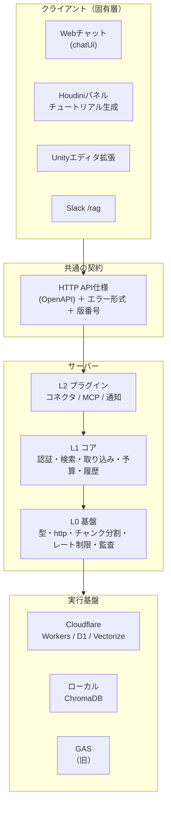

# 共通層・固有層の整理と、ライブラリ化・プラグイン化の設計案

**作成日:** 2026-10-17
**位置づけ:** 設計・提案書。この文書ではコードを変更しない。実際に着手するのは、末尾「§9 決めてほしいこと」の回答を受けてから。
**前提資料:** [distribution-strategy.md](distribution-strategy.md)（2026-08。配布方式の比較。Cloudflare版が無かった時点の調査）／[cloudflare-rag-technical-report.md](cloudflare-rag-technical-report.md)／[README.md](../../README.md)（ディレクトリ構成）

> この文書の数値（モジュールの依存数・行数）は、2026-10-17時点の `cloudflare-rag-poc/src/` を実際に集計した値。推測ではない。

---

## 1. 結論（先に要点）

1. **一番効くのは「共通のコード」より「共通の契約」を先に固めること。** このプロジェクトは、サーバー（GAS／Cloudflare Worker／ローカルブリッジ）と、クライアント（Webチャット／Unity／Houdini／Slack）が、HTTP APIでつながっている。この**APIの形（リクエスト・レスポンス・エラー）を仕様書にして版管理する**のが、共通層の核になる。
2. **Worker（`cloudflare-rag-poc`）は、既に層になっている。** 循環した依存は無く、`types`→`http`→各機能、の一方向。分け方を決めるだけで、大きな書き換えは要らない。
3. **プラグイン化に向くのは「外部サービスとの連携（コネクタ）」。** Notion／Drive／Gmail／カレンダー／Jira／Backlog の6つが、ほぼ同じ手順（認可 → プレビュー → 取得 → チャンク化 → 登録 → 通知）を、各230〜460行で6回書いている。ここを1つの共通エンジンと小さなコネクタに分けるのが、最も費用対効果が高い。
4. **固有層（Houdini／Unity／動画）は、「共通クライアント」と「固有ツール」に分ける。** Houdiniなら、チャット・設定・グラフ表示は共通、ノード操作やスクリーンショットは固有。
5. **大きな問題が1つある。** `chatUi.ts`（6,335行、Worker全体の約37%）が、画面を1つの文字列で持っている。配布・保守のどちらでも最大の障害なので、層分けの前に分解する。
6. DIコンテナや重いフレームワークは入れない。[README.md](../../README.md)の「アーキテクチャ判断」で既に見送っている。関数と登録表（レジストリ）で足りる。

---

## 2. 現状の測定結果

### 2.1 構成

| 場所 | 中身 | 行数・数 |
|------|------|---------|
| `cloudflare-rag-poc/src/` | Worker本体（TypeScript）61ファイル＋`mcp/`8ファイル | 約17,300行（`mcp/`を除く） |
| `cloudflare-rag-poc/migrations/` | D1のSQL（0001〜0030） | 30本 |
| `houdini/python_panels/` | Houdiniのパネル（Python、PySide6）9ファイル | 約7,200行 |
| `Assets/Editor/RAGChatbot/` | Unityエディタ拡張（C#）7ファイル | — |
| `scripts/` | ローカルRAG（ChromaDB）、MCPサーバー、GAS、各種ユーティリティ | 35ファイル |
| `docs/`・`lecture/` | 資料 | — |

### 2.2 Workerの依存関係（実測）

「何個のファイルから読まれているか」の上位:

| 読まれている数 | モジュール | 役割 |
|---:|---|---|
| 63 | `types` | 型と環境変数（`Env`）の定義 |
| 41 | `http` | レスポンス生成の共通関数 |
| 29 | `auth` | 認証・権限 |
| 13 | `syncTargets` | 連携の許可リスト・同期先の認可 |
| 13 | `chunking` | 文書のチャンク分割 |
| 13 | `kbIngest` | 取り込み（埋め込み → D1・Vectorize） |
| 11 | `embeddings` | 埋め込み・生成のGemini呼び出し |
| 10 | `oauthConnections` | OAuth接続の保存 |

読まれていないのは `index`（ルーティングの入口）だけ。つまり**循環が無く、下から上へ一方向**に積み上がっている。

気になる点（直すと層がきれいになる）:

| 問題 | 詳細 |
|------|------|
| `auth` が `embeddings` を読む | `sha256Hex`（ハッシュ関数）を使うためだけ。基盤の関数なので、`util`に移すべき |
| `types.ts` が全員の環境変数を持つ | 63ファイルが読む。連携ごとのsecret（Slack・Jira・Google…）も同居していて、プラグインを外せない |
| `index.ts` に122個のルートを手書き | 機能を足すたびに、入口を直接編集する |
| `chatUi.ts` が6,335行 | UIが1つの文字列。部品の再利用もテストもできない |
| コネクタの骨格が6回複製 | `*Sync.ts` が各230〜460行、`*OAuth.ts` が各170〜200行 |

---

## 3. 層のモデル



| 層 | 置くもの | 依存してよい先 | 例 |
|----|---------|---------------|-----|
| **契約** | APIの仕様、エラー形式、版番号 | なし | `/query`, `/search`, `/ingest`, `/admin/*` |
| **L0 基盤** | 他のどの機能にも属さない部品 | なし | `types`, `http`, `chunking`, `rateLimit`, `auditLog`, `budget`, `chunkRows` |
| **L1 コア** | このシステムの存在理由。外せない | L0 | `auth`, `embeddings`, `hybrid`/`retrieve`/`search`/`query`, `kbIngest`, `kbDocuments`, `memory`/`threads`/`presets`, `graph`, `syncTargets`, `oauthConnections` |
| **L2 プラグイン** | 無くても動く。足し引きできる | L0・L1 | 各コネクタ、`mcp/*`、`slackBot`、`urlImport`、`mediaImport` |
| **固有層** | 特定の用途・環境だけのもの | 契約（HTTP）だけ | Houdiniのノード操作、Unityのウィンドウ、動画生成 |

**守るルール（これだけ）:**
1. 依存は下向きだけ。L0はL1を、L1はL2を、読まない。
2. プラグインどうしは読み合わない。共通で使いたくなったら、L1に降ろす。
3. 固有層は、サーバーの内部（ファイル）ではなく、HTTP APIだけを使う。

---

## 4. Worker（TypeScript）の整理案

### 4.1 モジュールの振り分け

| 層 | ファイル |
|----|---------|
| L0 基盤 | `types`（コア分のみ）, `http`, `chunking`, `rateLimit`, `auditLog`, `budget`, `chunkRows`, `geminiFile` |
| L1 コア | `auth`, `embeddings`, `hybrid`, `retrieve`, `search`, `query`, `claude`（Claude中継）, `kbIngest`, `kbDocuments`, `kbRollback`, `kbAdmin`, `keyAdmin`, `namespaceAdmin`, `memory`, `threads`, `presets`, `graph`, `insights`, `usageStats`, `backup`, `syncTargets`, `oauthConnections`, `myConnections`, `staging`, `healthCheck`, `alerts` |
| L2 コネクタ | `notion`/`notionSync`, `driveSync`＋`docExtract`＋`mediaTranscribe`, `gmailSync`＋`gmailOAuth`, `calendarSync`＋`calendarOAuth`, `jiraSync`＋`jiraOAuth`, `backlogSync`＋`backlogOAuth`, `googleOAuth`＋`googleAuth`, `mapsImport` |
| L2 取り込み系 | `urlImport`＋`crawlSchedules`, `mediaImport`, `qaImport`, `faqAdd`, `ingest`（手動投入） |
| L2 その他 | `mcp/*`（公式MCPクライアント）, `slackBot`＋`slackOAuth`, `syncNotify` |
| 固有（Houdini） | `tutorialFeedback`（チュートリアル評価の保存・集計） |
| UI | `chatUi`（分解の対象） |

### 4.2 コネクタの契約（プラグインの形）

6つのコネクタが共通して行っていること:

```
認可（syncTargets）→ プレビュー → 取得（ページング）→ チャンク化 → 登録（kbIngest）→ 履歴・通知（syncNotify）
                    └ 失敗分だけ再同期 / 自動同期（明示的にオンのときだけ）
```

これを、次の形に分ける。

```ts
// 案。名前・形は着手時に詰める
interface Connector {
  id: "jira" | "backlog" | "gmail" | ...;
  label: string;                       // 画面に出す名前
  auth: { kind: "oauth" | "token" | "mcp"; /* 接続の仕方 */ };
  env: string[];                       // 必要な環境変数（無ければ画面で「未設定」）
  sourceSchema: SourceField[];         // 同期元の設定項目（プロジェクトキー、検索式など）
  list(cursor, ctx): Promise<{ items: ItemRef[]; next: Cursor | null }>;
  fetch(item: ItemRef, ctx): Promise<{ file: string; text: string }>;   // 1件を文書にする
  preview?(source, ctx): Promise<PreviewRow[]>;
  autoSync?: { default: false; schedule: "daily" };
}
```

共通エンジンが受け持つこと: 認可・許可リスト、バッチ分割と再開、プレビュー、失敗分の再同期、履歴（`kb_log`・`kb_ops`）、通知、自動同期のオプトイン、画面のフォーム生成。コネクタが受け持つこと: 「一覧の取り方」と「1件を文書にする」だけ。

**期待できること:** コネクタを足す作業が、数百行の複製から、約100行の定義に変わる（実測ではなく見込み。パイロットで確かめる）。許可リストやプレビューなどの安全策が、コネクタごとにバラつかなくなる。

### 4.3 環境変数とマイグレーションの扱い（プラグイン化の壁）

- **環境変数:** `types.ts` の `Env` を、`CoreEnv`（D1・Vectorize・GEMINI_API_KEY など）と、各プラグインの `env`（`SLACK_SIGNING_SECRET` など）に分ける。プラグインが読む値は、そのプラグインの宣言に書く。
- **マイグレーション:** D1は1本の連番ディレクトリ。プラグインごとに表を持つなら、**表名に接頭辞**（例 `slack_*`）を付け、ファイルは本体のディレクトリに残す方式が最も単純。プラグインの有無でマイグレーションを変える運用は、復元が難しくなるので避ける（未使用の空の表が残るだけで害は無い）。
- **ルート登録:** `index.ts` の手書きのcaseを、`{ path, handler, minRole }` の登録表に変え、各プラグインが自分のルートを登録する。権限（`minRole`）を表に書くことで、認可の付け忘れも防げる。

### 4.4 `chatUi.ts` の分解

6,335行のテンプレート文字列は、最優先で解く。順序の案:

1. 画面を静的ファイル（HTML・CSS・JS）にする。WorkersのStatic Assetsで配信できる。
2. JSを機能ごとのファイルに分ける（チャット／履歴／管理／ナレッジ登録／連携／グラフ）。
3. 連携の画面を、コネクタの `sourceSchema` から生成する（§4.2）。

これで、①UIのテスト、②部品の再利用、③「テンプレートリテラル内でバックスラッシュが使えない」などの制約の解消、が同時に得られる。

---

## 5. Houdini（Python）の整理案

| 共通（どの用途でも使う） | 固有（チュートリアル生成のためのもの） |
|---|---|
| `rag_chatbot.py`（チャット・設定のパネル） | `tutorial_agent.py`（生成のオーケストレーター） |
| `graph_view.py`（グラフ表示） | `houdini_tools.py`（`hou` を操作するツール群） |
| `token_usage.py`（残高の表示） | `tutorial_view.py`（Tutorial/Historyタブ） |
| 設定の読み書き（`~/.houdini/…json`） | `screen_capture.py`、`tutorial_graph_simplify.py` |
| | `video_factory_bridge.py`（動画生成の起動） |

- **配布の形:** [distribution-strategy.md §5](distribution-strategy.md#5-houdini21チュートリアル生成の配布) の推奨どおり、**Houdiniパッケージ（`.json`）**にする。さらに2つのパッケージに分ける案:
  - `devragenv-core`: 共通クライアント（チャット・設定・グラフ）
  - `devragenv-tutorial`: 固有（チュートリアル生成・動画）。`core` に依存
- **共通クライアント:** サーバーとのやりとり（認証・`/query`・`/search`・エラー処理）を1つのPythonモジュールに集める。Unity（C#）にも同じ役割のクラスがあるので、**仕様（§6）を共有**して、2言語で同じふるまいにする。
- **ツール定義の共有:** `HOUDINI_TOOLS`（ツールの名前・引数・説明）は、他のエージェントからも使える形（JSON Schema）で外に出せる。これはMCPサーバー化したい場合の土台にもなる（今は不要）。

## 6. 共通の契約（API仕様）

- 今の`/query`・`/search`・`/ingest`・`/graph`・`/admin/*`など約120のルートの、**リクエスト・レスポンス・エラー**を、1つの仕様書（OpenAPI）にまとめる。
- エラーの形を統一する（今は `{ "error": "文字列" }`）。クライアントが機械的に判断できるよう、`code`（例 `BUDGET_EXCEEDED`）を足す案。
- **版番号**を付ける（例 `GET /health` が `apiVersion` を返す）。クライアントは対応外の版なら案内を出せる。
- 仕様が3つの実装（GAS・Worker・ローカルブリッジ）の「どれが何を満たすか」の対応表にもなる（[gas-feature-parity.md](../reports/gas-feature-parity.md)の発展）。
- Unity・Houdiniのクライアントは、この仕様から作る（または仕様に対するテストで確認する）。

## 7. Unity・ローカルRAG・GAS

| 対象 | 方針 |
|------|------|
| Unity | `IRAGClient`（Cloud/Local）で既に抽象化済み。UPM（Unity Package Manager）のパッケージにして、Git URLで入れられる形にする。 |
| ローカルRAG（`scripts/`） | `pyproject.toml` に `[project.scripts]` を足して、コマンド（例 `devragenv-bridge`）として公開する（[distribution-strategy.md §2.4](distribution-strategy.md#24-推奨方式と実装ステップ概要)）。ローカルのブリッジは、契約（§6）の `/search`・`/query` を満たす実装として位置づける。 |
| GAS | 保守のみ。新機能は入れない（Worker側が上位互換）。契約のうち満たしている範囲を、対応表に残す。 |
| 動画生成（LearningQt） | 別リポジトリ。ffmpeg/x264のライセンス判断が先（[distribution-strategy.md §4.2](distribution-strategy.md#42-ライセンス上の重大な確認事項配布方式より先に解決すべき)）。 |

## 8. 進め方（段階と終了条件）

各段階は、**既存のテストと本番の挙動を変えずに**終えられる大きさにしてある。

| 段階 | やること | 終了条件 |
|------|---------|---------|
| **0. 下準備**（挙動は変えない） | `sha256Hex`を`util`へ。`Env`をコアと連携別に分割。ルート登録表の導入（既存caseを機械的に移す）。依存の方向を検査するスクリプトの追加 | 型チェックと既存テストが通る。検査スクリプトが、下から上への依存を0件と報告する |
| **1. 契約** | OpenAPI仕様の作成。エラー形式（`code`）の追加（後方互換）。`apiVersion`の追加 | 仕様に対する疎通テストが通る。Unity・Houdiniの既存クライアントが無改造で動く |
| **2. コネクタの共通化（パイロット1本）** | `Connector`インターフェースと共通エンジンを作り、**Backlog**（API形式が素直）を移行 | 旧実装と新実装で、同期結果（登録件数・内容）が一致する。残り5本の移行手順書ができる |
| **3. コネクタの全面移行** | 残りの連携を移行。連携画面を`sourceSchema`から生成 | 旧`*Sync.ts`を削除。コネクタ追加の手順が「定義を1ファイル書く」になる |
| **4. UIの分解** | `chatUi.ts`を静的ファイル化・機能別に分割 | 見た目と操作が変わらない（画面の確認＋ブラウザテスト） |
| **5. パッケージ化** | npm workspaces（`core`／`connectors`／`ui`／`app`）、Houdiniパッケージ2種、Unity UPM、`uv`のコマンド化 | 手順書どおりに、他の環境へ入れて動く（配布テスト） |

**先にやらない方がよいこと:** 5（パッケージ化）を最初にやること。層と契約が決まる前に箱を分けると、境界が間違っていたときに、分け直しのコストが大きい。

## 9. 決めてほしいこと

1. **配布の相手**は誰か。（A）自分の別プロジェクト・チーム内、（B）社外の技術者、（C）非技術者。Aなら段階0〜3で十分に価値がある。BとCは、5（パッケージ化）とインストール手順の整備が必要。
2. **段階2のパイロット**は、Backlogでよいか。（Jiraの方が使用頻度が高いなら、Jiraでもよい。）
3. **OpenAPI仕様**は、手で書くか、既存のコードから起こすか。（この規模なら、重要な20ルートを先に書き、残りを段階的に足すのが現実的。）
4. **GAS版**は、保守のみにする（新機能を入れない）でよいか。
5. **Cloud Run等の併用**は、今は見送ってよいか（比較は[cloudflare-vs-firebase-comparison.md §7](../reports/cloudflare-vs-firebase-comparison.md)。結論は「Workerが入口のまま、重い処理だけを、任意のプラグインとして足す」）。

## 10. リスク

| リスク | 対策 |
|--------|------|
| 抽象化しすぎて、読みにくくなる | インターフェースは1つ（`Connector`）。DIコンテナは入れない。最初は実装1本で確かめる |
| 層の境界が間違っていた | 段階2のパイロットで確かめてから、全面移行（段階3）へ進む |
| 移行中に本番が壊れる | 段階ごとに、旧実装と新実装の出力を比較するテストを作る。マイグレーションは追加のみ |
| D1の読み取り枠（無料）を使い切る | 2026-10-16に実際に発生。開発中のテストでも、リモートのD1を直接読まない。対応表`chunk_rows`（migrations/0030）を維持する |
| 1人で抱え込む | [docs/learning/](../learning/README.md)の資料で、AI無しでも保守・拡張できる土台を作る |
