# 通信構成 — どの部品が、何で、誰から誰へつながっているか

**更新日:** 2026-11-22

*図: 通信構成図。矢印は、通信を始める側から出る。常時接続（WebSocket など）は使っていない。番号は、下の表と同じ。*

## 1. 通信の一覧

外部との通信は、すべて **HTTPS** で、**パネル（クライアント）が呼びに行く**。

| # | つなぐ先 | 方式 | 認証・守り |
|---|---|---|---|
| 1 | Houdini パネル → Worker（rag-poc） | HTTPS の POST（JSON）。Chat は `/query`、実験の記録は `/pilot/*`、Reference は `/reference/*`、動画の音声は `/tts`、チュートリアルの生成は `/claude` | `Authorization: Bearer <API キー>`。キーはハッシュで照合する。User-Agent は `HoudiniRAGPanel/1.0`（Cloudflare は、標準の User-Agent を拒否する） |
| 2 | パネル → 動画エンジン（RAGReel） | **プロセスの起動**（コマンドライン引数と、手順書・スクリーンショットの一覧・台本のファイル）。通信ではない。進捗は、エンジンのログを 2 秒ごとに読む | 同じ PC の中。音声合成の鍵は、コマンドラインではなく環境変数で渡す（プロセス一覧に出ない） |
| 3 | パネル → ローカルブリッジ（Local モード） | `http://localhost:8766`（loopback の HTTP）。ブリッジ → ローカル LLM の窓口は `127.0.0.1:8800` | loopback 以外の窓口は、送る前に拒否する（資料の抜粋が、この PC の外へ出ない）。ブリッジは、鍵を環境変数に持ち、Claude・Gemini へ HTTPS で直接つなぐ |
| 4 | 動画エンジン → Worker | HTTPS の POST: 音声合成 `/tts`（最大 4 本並列） | Bearer キー |
| 5 | 動画エンジン → ギャラリー（ragreel-gallery） | HTTPS のアップロード。90MB を超える動画は、分けて送る | ギャラリー専用のトークン |
| 6 | ブラウザ → Worker・ギャラリー | HTTPS（管理画面・チャット UI・動画一覧） | 管理画面は、キーかトークン |
| 7 | Slack → Worker | Slack の Events API（HTTPS の POST） | 署名を検証する |
| 8 | パネル → GitHub（HoudiniReference） | HTTPS の GET（`raw.githubusercontent.com`）。1 日 1 回、手元にキャッシュ | 認証なし（公開ファイル）。題名・URL・日付・短い抜粋だけ |
| — | Worker → Gemini・Claude・Google TTS・公式 MCP | HTTPS の外部 API | **鍵は Worker の Secrets だけ**。予算つきで中継する（上限を超えると止まる） |
| — | Worker ⇔ D1・Vectorize・R2 | Cloudflare のバインディング（Worker 内部の呼び出し） | 通信の鍵は要らない（Worker にだけ紐づく） |

## 2. https について

- 外部との通信は、すべて https（Worker の URL は `https://rag-poc.manato1201m.workers.dev/`）。ギャラリーへのアップロードは、URL が `https://` で始まらなければ、エラーにして送らない。
- **http のままなのは、自分の PC の中だけ**（Local モードの `localhost`・`127.0.0.1`）。
- **既知の弱点（未対応）**: パネルの「Worker の URL」の入力欄は、`https://` かどうかを検査していない。`http://…` と入れると、リダイレクトで POST の本文が失われて失敗する（キーを含む通信が、http で出る恐れもある）。入力欄の例は https。直すなら、保存時と送信前に、「localhost 以外で `https://` で始まらない URL は拒否」を入れる。

## 3. 制限・再試行

- Worker は、**60 秒に 30 回まで**（利用者ごと）。超えると 429。動画の台本づくり・説明の一括作成は、間隔を空け、待って再試行する。
- 動画の音声合成は、クラウド TTS を最大 4 本並列で呼ぶ（429・エラーなし。直列の約 4 倍速い）。
- 認証後の Worker は **POST だけ**を受け付ける（取得も POST。本文は空でよい）。
- 通信に失敗したチュートリアルの評価は、未送信として手元に残し、次の起動で再送する。課題の振り返りは、答えを残して、「答えを再送する」で送り直せる。

## 4. 同時に走らせたとき

- 動画の作成（別プロセス）と、チュートリアルの生成は、**並行できる**。動画は、保存済みのファイルだけを読むので、Houdini のシーンの変化に影響されない。
- 画面の進捗表示は、動画 1 本分だけ。2 本目を始めると、表示が新しい動画に切り替わる（古い動画は、裏で作り続けられ、「動画」タブから開ける）。
- 重なると遅くなる（動画の描画と Houdini の cook が CPU を取り合う。Worker の 30 回 / 分の制限を、チュートリアルの生成と音声合成が分け合う）。**実験の計測中は、動画の生成と重ねない運用**を勧める。

## 5. 関連の資料

- [システム全体の構成（図 01）](../images/01-system-overview.svg)・[リクエストの一生（図 11）](../images/11-request-life.svg)・[セキュリティの層（図 07）](../images/07-security-layers.svg)
- [Reference タブの仕組み](reference-tab.md)・[Cloudflare RAG 技術解説書](cloudflare-rag-technical-report.md)
