# Houdiniチュートリアル・動画生成の配布計画（2026-10-20）

## 1. 範囲と相手

[](../images/06-distribution.svg)

*図: 配布と、キー・予算の管理。運営が配り、鍵と予算は運営の Worker で管理する。*

| 項目 | 内容 |
|---|---|
| 配るもの | Houdiniチュートリアル生成パネルと、動画生成エンジン（RAGReel） |
| 配らないもの | Cloudflare（Worker・D1・Vectorize）。あなたが運営し、テスターは接続するだけ |
| 相手1 | 企業の技術者。触ってもらい、実務・実用の観点でレビューを受ける |
| 相手2 | 学生（1〜3年）。学習効果などのメリットがあるかレビューを受ける |
| 4年生 | 卒論担当の先生と相談してから（同意・データの扱いを含む） |

Cloudflareを配らないので、テスターの**Claude利用料・音声合成の費用・データ・鍵**は、すべてあなたのWorkerを通る。

## 2. 音声: インストール不要のクラウド音声（実装済み）

```
動画エンジン ─(文章 + テスターの鍵)→ Worker POST /tts ─→ Google Cloud Text-to-Speech ─→ WAV
```

| 項目 | 内容 |
|---|---|
| Google の鍵 | Workerのシークレット `GOOGLE_TTS_API_KEY` にだけ置く。exeにもテスターにも渡さない |
| 声 | 既定は `ja-JP-Neural2-B`。`ja-JP-Chirp3-HD-*` も選べる。Studio など高額な声は通さない（正規表現で拒否） |
| 1回の文字数 | 1,200文字まで（Googleの入力上限は5,000バイト。日本語は1文字3バイト） |
| 上限 | 鍵ごとに1日 50,000文字（`TTS_DAILY_CHARS_PER_KEY`）、全体で1日 300,000文字（`TTS_DAILY_CHARS_GLOBAL`）。日本時間で切り替わる |
| 失敗したとき | 予約した文字数を払い戻す。声が速さの指定を受け付けないときは、速さなしで1回だけやり直す |
| キャッシュ | 同じ文章・声・速さは、Workerのキャッシュから返し、文字数を数えない |
| 切り替え | クラウド → VOICEVOX（導入済みなら自動起動）→ SAPI。どれが使われたかは、ログとパネルに出る |

接続先は、Houdiniの Settings タブにある Cloudflare URL / APIキーをそのまま使う。パネルが、環境変数 `RAGREEL_CLOUD_TTS_URL` / `RAGREEL_CLOUD_TTS_KEY` で動画エンジンへ渡す（コマンドラインには出さない）。

### 費用（公式の料金は契約前に確認）

| 声 | 100万文字あたり | 月の無料枠 |
|---|---|---|
| Neural2 | $16 | 100万文字 |
| Chirp 3: HD | $30 | 100万文字 |

動画1本は、定型の台本で約1,000〜1,300文字、Claudeが書く台本で約3,500文字（想定）、上限で約8,500文字。10人×5本×再生成2倍＝約35万文字で、無料枠に収まる見込み。

### Google側の安全装置（あなたの作業）

- 「割り当てとシステムの上限」で、1日あたりの文字数を下げる（予算アラートは通知だけで止まらない）。
- 「予算とアラート」で、$5 などのアラートを作る。

### 導入の手順（運営側）

1. マイグレーション `0031_tts_usage.sql` を、リモートD1へ適用する（`npm run db:migrate:remote`）。
2. Workerをデプロイする。
3. `npx wrangler secret put GOOGLE_TTS_API_KEY`（登録済み）。
4. 声を聞き比べる（Neural2 と Chirp 3: HD）。

## 3. ターゲット別のレビュー

| | 企業の技術者 | 学生（1〜3年） |
|---|---|---|
| 見てもらうこと | 実務で使えるか（正確さ・再現性・時間短縮） | 学習効果があるか |
| 向く内容 | レッスン3（再利用・書き出し） | レッスン1・2＋入門資料 |
| レビューの形 | チェックリスト＋ヒアリング | 課題を「ツールあり／なし」で比べる事前・事後テスト＋自信度アンケート |
| Houdini | 各社の有償版（Apprentice は商用不可） | Apprentice（無料）で足りる |
| 注意 | 社外秘のデータを入力させない | 同意書、匿名ID、成績と無関係であること |

## 4. 残りの作業と状態（2026-10-21）

| 作業 | 状態 |
|---|---|
| 音声のクラウド化（Worker `/tts`、動画エンジンのクラウド音声、切り替え） | **実装・デプロイ・実機確認済み**（音声は良好） |
| Houdiniパッケージ化（zip + `install.cmd`）、設定の自動化 | **実装済み**。Houdini 22（hython）が、パッケージとパネル定義を認識することを確認。インストール・更新・削除は、自動テスト。**配布前に、別のPCでの通しの確認が必要** |
| RAGReel インストーラー 1.1.0 | **作成・インストール／アンインストールを確認済み**（管理者権限なし、VC ランタイム同梱） |
| 企業向け・学生向けの導入ガイド | **取扱説明書を作成**（[manual-houdini-tutorial.md](../guides/manual-houdini-tutorial.md)、[manual-ragreel.md](../guides/manual-ragreel.md)）。同意書・質問票は未 |
| 運営者の手順書（鍵・予算・登録・デプロイ） | **作成**（[operator-runbook.md](../pilot/operator-runbook.md)） |
| 鍵ごとの予算の決め方 | **算出済み**: 420,000 トークン / 人（[cost-and-quota.md](../operations/cost-and-quota.md)） |
| 公式ドキュメント約2,000ページの登録（章の見出し・並べ替え・あいまいなときの決まり） | **実装・自動テスト済み。未デプロイ・未登録**（手順は [operator-runbook.md §5](../pilot/operator-runbook.md)） |
| レビュー用の質問票（企業・学生の事前・事後テストと、同意書） | 未 |
| 実機での検証（レッスン設計の質、Parm ペインの切り出し、プログレスバー、チャット後のレイアウト） | **一部**（設計の質・音声・動画は確認。左記の3点は、再配置後の確認待ち） |
