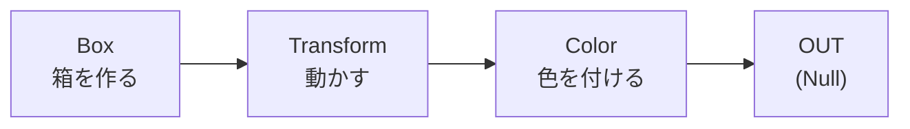
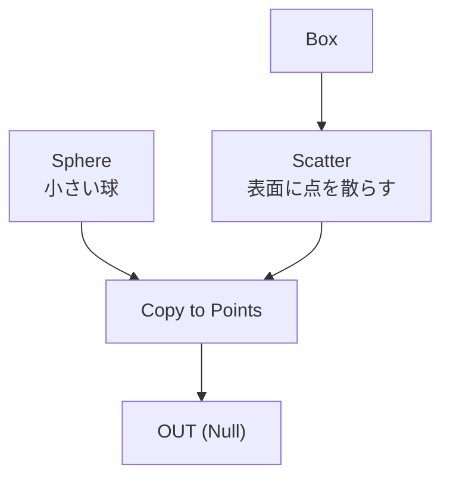

# Houdini 初心者ガイド（基礎知識とショートカットキー一覧）

**作成日:** 2026-10-17
**対象:** Houdiniを初めて触る人。ゲーム開発者（Unity・Unreal）を想定。
**対象バージョン:** Houdini 21（キーの一覧は、公式の21.0／22.0のページで確認。同じ内容）
**この資料の位置づけ:** 「Houdiniの考え方」と「手を動かすためのキー」を、1か所にまとめたもの。チュートリアルの自動生成（[content-generation.md](content-generation.md)）が作る教材を読む前の、**予習用**。

> **ショートカットキーについて:** §10の一覧は、SideFX公式ドキュメント（[Hotkey Quick Reference](https://www.sidefx.com/docs/houdini/start/hotkeys.html)、[Network editor shortcuts](https://www.sidefx.com/docs/houdini21.0/network/shortcuts.html)、[Node flags](https://www.sidefx.com/docs/houdini/network/flags.html)）に基づく。**キーは変更できる**（Edit → Hotkeys）。一覧と合わないときは、そこで現在の割り当てを確認する。
> 公式ページが22.0版のため、**21.0で一部違う可能性**がある。違いに気づいたら、この資料を直す。

---

## 目次

1. [Houdiniとは何か](#1-houdiniとは何か)
2. [画面の構成](#2-画面の構成)
3. [ノードとネットワーク](#3-ノードとネットワーク)
4. [ジオメトリの基礎（ポイント・アトリビュート）](#4-ジオメトリの基礎ポイントアトリビュート)
5. [パラメータと式](#5-パラメータと式)
6. [はじめての作例](#6-はじめての作例)
7. [VEXとWrangle入門](#7-vexとwrangle入門)
8. [保存・ファイル・ゲームエンジンへの出力](#8-保存ファイルゲームエンジンへの出力)
9. [つまずきやすい点](#9-つまずきやすい点)
10. [ショートカットキー一覧](#10-ショートカットキー一覧)
11. [学習のロードマップ](#11-学習のロードマップ)
12. [このプロジェクトとの関係](#12-このプロジェクトとの関係)
13. [用語集](#13-用語集)

---

## 1. Houdiniとは何か

**Houdini**（SideFX社）は、3DのモデリングやVFX（煙・炎・水・破壊など）、アニメーション、レンダリングを作るソフト。他の3Dソフトとの最大の違いは、**手続き型（プロシージャル）**であること。

| 他のソフトでの考え方 | Houdiniでの考え方 |
|---|---|
| 形を、手で直接変形して作る | **作り方（手順）を、ノードでつないで作る** |
| 途中を変えると、やり直しになる | **手順のどこでも変えられる**（変更が、後ろのノードに流れる） |
| 完成した形が、成果物 | **手順そのものが、成果物**（パラメータを変えれば、別の形が作れる） |

**プロシージャルの利点（ゲーム開発の場面で）**
- 建物・地形・植生のバリエーションを、**パラメータを変えるだけで量産**できる。
- 「やっぱり、窓の数を増やしたい」が、最初からやり直さずに済む。
- 作った手順を、**HDA（Houdini Digital Asset）**にして、他のプロジェクトや、**Houdini Engine**経由でUnity・Unrealの中でも使える。

### エディション

| エディション | 用途 |
|---|---|
| **Apprentice** | 無料。学習・個人の非商用 |
| **Indie** | 年間の収益が小さい個人・小規模向けの、低価格の商用版 |
| **Houdini FX / Core** | 商用の標準版 |

> 条件（収益の上限・出力の制限など）は変わる。**使う前に、SideFXの公式ページで確認する。**
> ファイルの拡張子は、エディションで違う: `.hip`（FX・Core）、`.hiplc`（Indie）、`.hipnc`（Apprentice）。

## 2. 画面の構成

Houdiniの画面は、**ペイン（区画）**の集まり。ペインの組み合わせを**デスクトップ**と呼び、用途別（Build、Animate、Technical など）が用意されている。

| ペイン | 役割 | キー |
|---|---|---|
| **Scene View**（シーンビュー） | 3Dの表示。形を見る・触る | `Alt+1` |
| **Network Editor**（ネットワークエディタ） | **ノードをつなぐ場所。Houdiniの作業の中心** | `Alt+2` |
| **Parameters**（パラメータ） | 選んだノードの設定項目 | `Alt+3` |
| **Tree View**（ツリービュー） | ネットワークの階層の一覧 | `Alt+4` |
| **Textport**（テキストポート） | コマンド・Pythonの入出力 | `Alt+5` |
| **Animation Editor** | アニメーションのカーブ | `Alt+6` |
| **Material Palette** | マテリアルの一覧 | `Alt+7` |
| **Details View**（ジオメトリスプレッドシート） | **ポイントなどの値を、表で見る** | `Alt+8` |
| **Timeline**（タイムライン） | 画面の下。フレームの再生・移動 | `↑↓←→` |
| **Shelf**（シェルフ） | 画面の上。よく使う道具のボタン | — |

- **Tab（タブメニュー）:** ネットワークエディタで`Tab`を押すと、ノードの一覧が出る。**名前の一部を打つと絞り込まれる**。ノードを作る基本の方法。
- ペインは、タブで切り替えたり、分割したりできる。**Parametersは、ネットワークエディタ上で`P`を押すと、浮かせて出せる**（§10）。
- **Details View（Geometry Spreadsheet）は、最初に覚えると、理解が速い。** 「いま、ポイントにどんな値が入っているか」が、数字で見える。

## 3. ノードとネットワーク

### 3.1 ノード

**ノード**は、1つの処理（箱を作る、動かす、色を付ける…）の部品。**入力（上）から出力（下）へ**、線（ワイヤ）でつなぐ。上から下へ、データが流れる。



- つなぐ順番が、結果を決める。**順番を入れ替えると、結果が変わる。**
- ノードを選ぶと、**Parameters**に、そのノードの設定が出る。パラメータを変えると、その下流が、**自動でやり直される**（cook）。

### 3.2 cook（クック）

ノードが、入力から出力を**計算し直す**こと。パラメータや入力が変わったときに、必要なノードだけが、cookされる。
- ノードが**赤く表示される**／警告が出るのは、cookのエラー。**まず、Parametersと、ノードを右クリックして出るメッセージを読む。**
- 重い処理は、cookに時間がかかる。**途中の結果を保存（キャッシュ）**して軽くする（§8）。

### 3.3 コンテキスト（ネットワークの種類）

ノードは、**種類（コンテキスト）**ごとの、別々のネットワークに置く。**他の種類のノードは、置けない。**

| コンテキスト | 略称 | 何を作るか |
|---|---|---|
| Object | OBJ（`/obj`） | シーンの入れ物。ジオメトリ・カメラ・ライトを置く |
| Geometry | **SOP** | **形（ポイント・面）を作る・加工する。最も使う** |
| Dynamics | DOP | シミュレーション（剛体・流体・布など）の仕組み |
| VEX Operator | VOP | ノードをつないで、シェーダや計算を作る（VEXのノード版） |
| Compositing | COP | 画像・テクスチャの処理（21ではCopernicus） |
| Solaris | LOP | USDのシーンの組み立て・ライティング・レンダリング |
| Task | TOP | 処理の自動化・分散（PDG）。大量の処理の管理 |
| Channel | CHOP | アニメーションや音の、チャンネル（時間で変わる値）の処理 |
| Render | ROP | 出力（レンダリング・ファイルの書き出し）の指示 |

**階層の例:** `/obj/geo1/box1` ＝ ObjectネットワークのなかのGeometryノード`geo1`の、さらに中にある、SOPノード`box1`。

- **Geometryノード（`geo1`）の中に入るには、ダブルクリック（または`Enter`）。1つ上に戻るには`U`**。
- **よくある間違い:** `/obj`の階層に、SOPのノード（Boxなど）を置こうとする。**まず、`/obj`にGeometryノードを作り、その中に入る。**

### 3.4 フラグ

ノードの状態を決める、小さなスイッチ。SOPでは、次の5つを、特に使う。

| フラグ | キー | 意味 | 見た目 |
|---|---|---|---|
| **Display**（表示） | `R` | **このノードの結果を、ビューに出す** | 青い旗（右） |
| **Render**（レンダー） | `T` | レンダリングに使う結果 | 紫の旗 |
| **Bypass**（バイパス） | `Q` または `B` | このノードを**飛ばして**、入力をそのまま通す（消さずに無効化） | 黄色の旗（左） |
| **Template**（テンプレート） | `E` | ガイドとして、薄く表示する（編集の目印に使う） | 栗色の旗 |
| **Lock**（ロック） | メニュー | 結果を固定し、cookを止める | 赤い旗 |

- **「ビューに何も出ない」は、Displayフラグが、別のノードに立っているのが原因のことが多い。** 見たいノードの、青い旗をクリックする（または選んで`R`）。
- 長いネットワークの最後には、**`Null`ノードを置き、名前を`OUT`にして、そこにDisplay・Renderフラグを立てる**のが、定番の習慣。（途中のノードを入れ替えても、出力の場所が変わらない。他のネットワークからも、`OUT`を参照できる）
- フラグは、ネットワークの種類で、少し違う（§10.7）。

## 4. ジオメトリの基礎（ポイント・アトリビュート）

### 4.1 ジオメトリの部品

| 部品 | 意味 |
|---|---|
| **ポイント（Point）** | 空間の点。位置（`P`）などの値を持つ |
| **頂点（Vertex）** | 面が、ポイントを参照する「つなぎ目」。UVや法線を、面ごとに変えたいときに登場する |
| **プリミティブ（Primitive）** | 面・曲線など、ポイントを束ねたもの（ポリゴンの面など） |
| **ディテール（Detail）** | ジオメトリ全体で、1つだけの値 |

### 4.2 アトリビュート

ポイントや面に付ける、**値のラベル**。Houdiniは、あらゆるものを、**アトリビュートで表す**。

| 名前 | 意味 | 型 |
|---|---|---|
| `P` | 位置 | ベクトル（x, y, z） |
| `N` | 法線（面の向き） | ベクトル |
| `Cd` | 色（Color） | ベクトル（r, g, b。0〜1） |
| `uv` | テクスチャ座標 | ベクトル |
| `pscale` | 大きさ（コピーするときなど） | 数値 |
| `id` | 識別番号（パーティクルなど） | 整数 |
| `v` | 速度 | ベクトル |

- **Details View（`Alt+8`）で、いつでも値を確認できる。** ノードを選んで、Displayフラグを立てて、表を見る。
- 自分で、好きな名前のアトリビュートも作れる（例: `height`）。
- **グループ**: ポイントや面を、名前をつけて束ねる。「この部分だけ動かす」のような、一部への処理に使う。

### 4.3 座標と単位

- **1単位 ＝ 1メートル。Yが上**（Y-up）。UnityもY-upだが、**Unityは左手系、Houdiniは右手系**。Zの向きなどで、出力時に注意が必要。
- スケールが合わないときは、まず、**単位（メートル／センチメートル）**を疑う。

## 5. パラメータと式

### 5.1 パラメータの基本

- 数字の欄は、**数字を直接入力**、スライダーのドラッグ、または**式を入力**できる。
- 欄の左のラベルを**右クリック**すると、キーフレームの設定、リセット（Revert to Defaults）などの、メニューが出る。
- 式やキーフレームが入っている欄は、**色が変わって表示される**（普通の数値の欄と、見分けがつく）。色の意味は、Houdiniのバージョンや設定で違うことがある。

### 5.2 式（Expression）

欄に、数字の代わりに、式を書ける。

| 式 | 意味 |
|---|---|
| `$F` | 現在のフレーム番号 |
| `$FF` | 現在のフレーム（小数） |
| `$T` | 現在の時間（秒） |
| `$FPS` | 1秒あたりのフレーム数 |
| `$HIP` | 現在のシーンファイル（`.hip`）のフォルダ |
| `$HIPNAME` | シーンファイルの名前 |
| `sin($T)` | サイン波（関数も使える） |
| `ch("../box1/sizex")` | 別のノードのパラメータの値を**参照** |
| `` `ch("size")` `` | **文字列の中**で式を使うときは、バッククォート（`` ` ``）で囲む |

- **`ch()`による参照は、手順をつなげる最も基本の方法。** 元の値を変えると、参照している値も、変わる。
- `$F`は**整数**。小数が必要なときは`$FF`。
- 式を、**数字に戻したい**ときは、欄を空にして入力し直す。

### 5.3 アニメーションの基本

- **キーフレーム**: パラメータのラベルを右クリック → キーを設定。または、ビュー上で`K`（キーフレームを設定）。
- フレームの移動は、タイムラインの`←`・`→`、再生は`↑`（逆再生は`↓`）。
- カーブの調整は、Animation Editor（`Alt+6`）。

## 6. はじめての作例

目的: **「箱の表面に、球を散らす」**。手順がつながる感覚を、つかむ。

1. 画面の下部の、**ネットワークエディタ**で、`/obj`にいることを確認。`Tab` → `geo`と打って、**Geometry**を作る。ダブルクリックで中に入る。
2. `Tab` → `box`。**Boxノード**ができる。Displayフラグが立っていることを確認（形が見える）。
3. `Tab` → `scatter`。BoxのOUTPUT（下の丸）から、**Scatterノードの上**へ、ドラッグしてつなぐ。Box表面に、**点**が散る。Parametersの **Force Total Count** を変えて、点の数を変える。
4. `Tab` → `sphere`。**Sphereノード**を作る（Radiusを小さく。例 `0.05`）。
5. `Tab` → `copytopoints`（**Copy to Points**）。**1つ目の入力**に、Sphere（コピーする形）、**2つ目の入力**に、Scatter（置き場所の点）をつなぐ。Displayフラグを、Copy to Pointsに立てる。
6. 球が、点の位置に並ぶ。**ScatterのSeed**や、**Box のサイズ**を変えて、**全体が自動で変わる**ことを確かめる。
7. 最後に`Tab` → `null`、名前を`OUT`にして、Copy to Pointsの後ろにつなぎ、**そこにDisplay・Renderフラグ**を立てる。



**ここで学ぶこと:** ①`Tab`でノードを作る ②上から下へつなぐ ③**入力の順番に意味がある**（Copy to Pointsは、1つ目が形、2つ目が位置） ④どこかを変えると、**全体が自動で追従する**。

## 7. VEXとWrangle入門

**VEX**は、Houdiniの、高速な計算用の小さな言語。**Attribute Wrangle**ノードに書くと、**ポイントごとに、同じ処理が実行される**。

### 7.1 基本

`Tab` → `attribwrangle`（**Attribute Wrangle**）。**VEXpression**欄に書く。

| 書き方 | 意味 |
|---|---|
| `@P` | ポイントの位置（`P`）。`@`で、アトリビュートを読み書き |
| `@Cd` | ポイントの色 |
| `@ptnum` | ポイントの番号（0から） |
| `@numpt` | ポイントの総数 |
| `@Time` | 現在の時間（秒） |
| `@Frame` | 現在のフレーム |
| `;`（セミコロン） | **文の終わり。書き忘れるとエラー** |

### 7.2 例

```c
// ポイントごとに、ランダムな色を付ける
@Cd = rand(@ptnum);          // rand()は、番号から、0〜1の値（色にもなる）
```

```c
// 時間に合わせて、上下に波打たせる
@P.y += sin(@P.x * 2 + @Time) * 0.2;
```

```c
// スライダーを作って、強さを調整する（パラメータの横の、設定ボタンから自動生成できる）
@P += @N * chf("amount");    // chf("名前") は、浮動小数のパラメータを読む
```

- **Run Over**（何ごとに実行するか）の設定が、Pointsなら、ポイントごと。Primitives、Detail（1回だけ）もある。
- エラーのときは、ノードに警告が出る。**行番号とメッセージを読む。**
- 最初は、**ノードだけで作って**、慣れてから、Wrangleに置き換える方が、理解しやすい。

## 8. 保存・ファイル・ゲームエンジンへの出力

### 8.1 保存

- シーンは、`.hip`（エディションによって`.hiplc`／`.hipnc`）。**こまめに保存する。** 自動バックアップもあるが、頼らない。
- `$HIP`が、そのシーンのフォルダ。**ファイルのパスは、`$HIP/geo/…`のように、相対的に書く**と、フォルダごと移動しても壊れない。
- **シーンを開く前に、保存場所の確認**。別のバージョンで保存したファイルを、古いバージョンで開けないことがある。

### 8.2 キャッシュ（重い処理を保存する）

- **File Cache**ノードで、途中の結果を、ファイル（`.bgeo.sc`など）に書き出し、**読み込み専用にできる**。重いシミュレーションの再計算を避けられる。
- キャッシュを読み込みに切り替えたら、**上流のノードを変えても、結果が変わらない**ことに注意。更新するときは、書き出し直す。

### 8.3 ゲームエンジンへの出力

| 方法 | 内容 |
|---|---|
| **Houdini Engine** | Unity・Unrealの中で、HDAを実行。パラメータを、エンジン側から調整できる |
| **FBX・Alembic・USD などの書き出し** | ROP（Render）ネットワークの、出力用ノードから書き出す |
| **ゲーム向けのツール群** | SideFXが、ゲーム開発向けのツールセット（Game Development Toolset）を公開している |

> 手順や対応バージョンは、**使う前に、SideFXの公式ドキュメントで確認する。** Houdini EngineのUnity・Unreal対応のバージョンは、Houdiniの更新に追従するまで、ずれることがある。

## 9. つまずきやすい点

| 症状 | 原因と対処 |
|---|---|
| ビューに、何も出ない | **Displayフラグ**が、別のノードにある。見たいノードで`R`を押す。または、`Space+H`／`Space+A`で、全体を表示 |
| ノードが**赤い**・エラー | cookエラー。ノードを選んで、メッセージを読む。つなぎ忘れ（入力が空）が、よくある原因 |
| ノードを置けない | **コンテキストが違う**（例: `/obj`にSOPを置こうとした）。Geometryノードの**中**に入る |
| `Tab`で、目的のノードが出ない | 名前が違う。英語で、一部を打つ。別のネットワークの種類では、出ない |
| 値を変えても、変化しない | その下流に、**Lock**や、**File Cacheの読み込み**がある。**Bypass**が立っている |
| 形が、思った場所に出ない | 単位（m／cm）、座標系（右手系／左手系）。**Details View**で`P`を確認 |
| Wrangleでエラー | `;`の書き忘れ。アトリビュート名の綴り。**型**（数値とベクトルの混同） |
| 触ってはいけないものを触った | `Ctrl+Z`（元に戻す）。メニューのEditで確認 |
| 昨日の自分の作業が分からない | **ノードに名前を付ける**。**Sticky Note**（`Shift+P`）や、**Network Box**（`Shift+O`）で、まとめて説明を書く |

## 10. ショートカットキー一覧

**出典:** SideFX公式（[Hotkey Quick Reference](https://www.sidefx.com/docs/houdini/start/hotkeys.html)／[Network editor shortcuts（21.0）](https://www.sidefx.com/docs/houdini21.0/network/shortcuts.html)／[Node flags](https://www.sidefx.com/docs/houdini/network/flags.html)）。
**表記:** `LMB`＝左クリック、`MMB`＝中クリック、`RMB`＝右クリック、`Wheel`＝ホイール。**キーの割り当ては変更できる**（Edit → Hotkeys）。

### 10.0 まず覚える10個

| キー | 動作 |
|---|---|
| `Tab`（ネットワークエディタ） | ノードを作る |
| `Space + LMB`ドラッグ | ビューを回す（Tumble） |
| `Space + MMB`ドラッグ | ビューを平行移動（Track） |
| `Space + RMB`ドラッグ／`Wheel` | ズーム（Dolly） |
| `Space + A` | すべてのオブジェクトを画面に収める |
| `Space + G` | 選んだものを画面に収める |
| `H`／`G`（ネットワークエディタ） | すべてのノード／選んだノードを画面に収める |
| `R`（ネットワークエディタ） | Displayフラグを立てる（SOPの場合） |
| `Q`（または`B`） | Bypass |
| `P`（ネットワークエディタ） | Parametersを浮かせて出す・隠す |

### 10.1 全般・表示（ビュー）

**ヒント:** `Space`または`Alt`を押している間は、一時的に**ビューの操作モード**になる。

| キー | 動作 |
|---|---|
| `Tab` | 使えるノードのメニューを開く |
| `Space + LMB` | 回転（Tumble） |
| `Space + RMB`／`Wheel` | ズーム（Dolly） |
| `Space + MMB` | 平行移動（Track） |
| `Space + Ctrl + LMB` | カメラの傾き（Tilt） |
| `Space + Ctrl + RMB` | カメラのレンズのズーム |
| `Ctrl + Alt + LMB` | 範囲を指定してズーム（Box zoom） |
| `Space + Z` | ポインタの下の点を中心に回転 |
| `Space + H` | 標準の表示に戻す |
| `Space + A` | すべてのオブジェクトを表示に収める |
| `Space + G` | 選んだものを表示に収める |

**ポインタがビューの上にあるとき**

| キー | 動作 |
|---|---|
| `W` | シェーディング表示／ワイヤーフレーム表示の切り替え |
| `D` | 表示オプション（Display Options）のウィンドウ |
| `Space + B` | 1画面／4画面の切り替え |
| `Space + O` | 正投影／透視投影の切り替え |
| `Space + E` | 1つのビュー／すべてのビューの切り替え |
| `Space + 1` | 透視（Perspective）ビュー |
| `Space + 2` | 上（Top） |
| `Space + 3` | 前（Front） |
| `Space + 4` | 横（Side） |
| `Space + 5` | UVエディタ |

### 10.2 ツール

| キー | 動作 |
|---|---|
| `S` | 選択ツール（アイコンを右クリックで、選択の方式のメニュー） |
| `T` | 移動（Move） |
| `R` | 回転（Rotate） |
| `E` | スケール（Scale） |
| `Enter` | ノード固有のハンドル |
| `Esc` | ビューの操作 |

> **注意:** `T`・`R`・`E`は、**ビューの上**では移動・回転・スケール。**ネットワークエディタの上**では、**フラグ**のキー（§10.5）になる。ポインタの位置で、意味が変わる。

### 10.3 選択

| キー | 動作 |
|---|---|
| `F8` | オブジェクト選択／コンポーネント選択の切り替え |
| `1` | オブジェクトを選択 |
| `2` | ポイントを選択 |
| `3` | エッジ（辺）を選択 |
| `4` | プリミティブ（面）を選択 |
| `5` | 頂点を選択 |
| `6` | パーティクルを選択 |
| `7` | ダイナミクスを選択 |

**選択しているとき**

| キー | 動作 |
|---|---|
| `LMB` | 選択 |
| `Ctrl + Shift + LMB` | 選択に追加 |
| `Ctrl + LMB` | 選択から外す |
| `Shift + LMB` | 選択の切り替え（Toggle） |
| `N` | すべてを選択 |
| `Shift + N` | 何も選択しない |

### 10.4 アニメーション・タイムライン

| キー | 動作 |
|---|---|
| `K` | キーフレームを設定 |
| `Alt + K` | オートキーの切り替え |
| `Ctrl + K` | ハンドルにキーを設定 |
| `Shift + T` | 移動にキー |
| `Shift + R` | 回転にキー |
| `Shift + E` | スケールにキー |
| `↑` | 順方向に再生 |
| `↓` | 逆方向に再生 |
| `Ctrl + ↑` | 最初のフレームへ |
| `←` | 前のフレーム |
| `→` | 次のフレーム |
| `Ctrl + ←` | 前のキーフレーム |
| `Ctrl + →` | 次のキーフレーム |

### 10.5 ペイン（画面の区画）

| キー | 動作 |
|---|---|
| `Alt + 1` | Scene View |
| `Alt + 2` | Network Editor |
| `Alt + 3` | Parameters |
| `Alt + 4` | Tree View |
| `Alt + 5` | Textport |
| `Alt + 6` | Animation Editor |
| `Alt + 7` | Material Palette |
| `Alt + 8` | Details View（ジオメトリスプレッドシート） |
| `Alt + 9` | Scene View |
| `Ctrl + T` | 新しいタブ |
| `Alt + Shift + C` | タブを、別のウィンドウに切り離す |
| `Ctrl + PgUp`／`Ctrl + PgDn` | 前のタブ／次のタブ |
| `Ctrl + W` | タブを閉じる |
| `Alt + /` | すべてのタブを閉じる |

### 10.6 ネットワークエディタ

**表示**

| キー | 動作 |
|---|---|
| `Space + LMB`（または`MMB`） | 平行移動（Pan） |
| `Space + RMB`（または`Wheel`） | ズーム |
| `H` | すべてのノードを表示に収める |
| `G` | 選んだノードを表示に収める |

**ノードの追加**

| キー | 動作 |
|---|---|
| `Tab` | メニューから、ノードを追加 |
| `=` | Fileノードを追加（そのネットワークにある場合） |
| `Shift + O` | **ネットワークボックス**を追加（選んだノードが、中に入る） |
| `Shift + P` | **付箋（Sticky Note）**を追加 |

**ワイヤ（線）のつなぎ方**

| 操作 | 動作 |
|---|---|
| コネクタを`LMB`でドラッグ | つなぐ（コネクタを順にクリックしても、つなげる） |
| コネクタを`RMB` | つないだノードの手前に、新しいノードを挿入 |
| コネクタを`MMB` | コネクタから、新しいノードを分岐させる |
| ノードを`Alt + LMB` | つなげるコネクタのメニューを表示 |
| `Y` + ドラッグ | ワイヤを横切って、切る |
| ノードを**振る（シェイク）** | すべてのワイヤから外す |
| ワイヤを`Alt + LMB` | ドット（中継点）を追加 |
| ドットを`Alt + LMB` | ドットを固定／固定解除 |

**ツールの表示・非表示**

| キー | 動作 |
|---|---|
| `P` | **パラメータエディタ**（右上に浮かせる）の表示・非表示 |
| `Shift + W` | ネットワーク階層のツリー（左）の表示・非表示 |
| `O` | ネットワーク全体の概観（左下）の表示・非表示 |
| `C` | カラーパレット（右下）の表示・非表示 |
| `Z` | 形状（シェイプ）パレット（右下）の表示・非表示 |

**ナビゲーション（階層の移動）**

| キー | 動作 |
|---|---|
| ダブルクリック／`Enter` | ノードの中に入る（`Enter`は、選んだノードに対して） |
| `U` | 1つ上の階層に戻る |
| `Ctrl + 1〜5` | 現在の表示位置を、クイックマークに記憶 |
| `Shift + 1〜5` | 記憶した位置に戻る |
| `` ` ``（バッククォート） | 1つ前の表示に戻る |
| `PgUp` | 上流のノードを選択 |
| `PgDn` | 下流のノードを選択 |
| `Shift + PgUp`／`Shift + PgDn` | 前／次の、兄弟のノードを選択 |

**ノードの操作**

| 操作 | 動作 |
|---|---|
| ノードを`MMB`で押し続ける | ノードの情報ウィンドウを、押している間表示 |
| ノードを`Shift + MMB` | **cookせずに**情報ウィンドウを表示 |
| `Alt` + ノードをドラッグ | ノードをコピー |

**ノードの整列**

| 操作 | 動作 |
|---|---|
| `A` + ノードをドラッグ | 上／左へドラッグで、上流のノードを整列。下／右へで、下流のノードを整列（選択があるときは、選んだものだけ） |
| `Shift + A` + ノードをドラッグ | 選んだノードを、対象のノードに揃える |
| `Alt + A` + ノードをドラッグ | 選んだノードを、等間隔に並べる |

**クリックとドラッグ（組み合わせ）**

| 入力 | 動作 |
|---|---|
| `LMB` | 選択 |
| `Shift + LMB` | 選択に追加 |
| `Ctrl + LMB` | 選択から外す |
| `Alt + Shift + LMB` | そのノードと、**すべての入力側**を選択 |
| `Alt + Ctrl + LMB` | そのノードと、**すべての出力側**を選択 |
| ドラッグ | 移動 |
| `Shift` + ドラッグ | ノードと、その入力側を、まとめて移動 |
| `Ctrl` + ドラッグ | ノードと、その出力側を、まとめて移動 |
| `Alt + Ctrl + Shift` + ドラッグ | 選んだノードの、**参照コピー**を作る |

**ノート・ネットワークボックス**

| キー | 動作 |
|---|---|
| `Shift + P` | 付箋を追加 |
| `Shift + O` | 選んだものを、ネットワークボックスに入れる |
| `Shift + J` | 選んだ付箋・ボックスを、最小化 |
| `Shift + K` | 最小化したものを、元に戻す |
| `Shift + M` | 選んだネットワークボックスを、中身に合わせて縮める |

**検索**

| キー | 動作 |
|---|---|
| `Ctrl + F`（または`/`） | 検索ダイアログ |
| `Ctrl + G`（または`>`） | 次の一致を選択 |
| `Shift + Ctrl + G`（または`<`） | 前の一致を選択 |

### 10.7 フラグのキー（ネットワークエディタ）

**`Q`・`W`・`E`・`R`・`T`が、フラグのキー。**ノードを選んで押すと、切り替わる。**押し続けて、ノードをクリックする**と、複数を、まとめて設定・解除できる。**`Q`と`B`は、常にBypass**。公式の説明では、**`R`が最もよく使うフラグ**、次に`E`、`T`、`W`の順。

ネットワークの種類で、フラグの意味が違う（公式の[Node flags](https://www.sidefx.com/docs/houdini/network/flags.html)より）。

| ネットワーク | `Q`／`B` | `W` | `E` | `R` | `T` |
|---|---|---|---|---|---|
| **Object**（`/obj`） | — | — | Selectable（ビューで選べる） | **Display**（ビューに出す） | — |
| **SOP**（ジオメトリ） | **Bypass** | Selectable Template | Template | **Display** | Render |
| **DOP**（ダイナミクス） | **Bypass** | — | Hidden（隠す） | Output（シミュレーションの出力） | — |
| **COP**（Copernicus） | **Bypass** | Shaded Template | Template | **Display** | 3D Output |
| **ROP**（レンダー） | **Bypass** | — | — | — | Render（レンダー実行のボタン） |
| **VOP** | **Bypass** | — | — | Debug | — |
| **CHOP** | **Bypass** | — | Export | **Display** | Output |
| **TOP**（タスク） | **Bypass** | — | — | — | Output |

> 表の「—」は、公式のページに、そのキーの記載が無いもの。**Lock・Unload・Materialなどは、キーが無く**、ノードを右クリック → Flagsのメニューで設定する。

### 10.8 キーを自分で確認・変更する

- メニューの **Edit → Hotkeys** で、すべての割り当てを、確認・変更できる。
- `Ctrl + Alt + Shift` を押しながら、画面上のボタンやメニューを`LMB`クリックすると、**そのボタンに対応するキーの設定画面**が開く。
- 保存・元に戻す・コピーなど、一般的な操作（`Ctrl+S`・`Ctrl+Z`など）は、公式の一覧ページには載っていない。**Editメニュー・Fileメニューに、割り当てが表示される**ので、そこで確認する。

## 11. 学習のロードマップ

| 段階 | 目標 | 内容 |
|---|---|---|
| **1. 触る**（1〜2日） | 画面とノードに慣れる | §2〜§6。Box・Scatter・Copy to Pointsの作例。キーを10個使う |
| **2. 理解する**（1〜2週間） | アトリビュートと流れを理解する | §4・§5。Details Viewで値を見る。`ch()`で参照する。Transform・Merge・Blast・Polyextrudeなどの基本ノードを使う |
| **3. 作る**（1〜2か月） | 小さな成果物を作る | 例: 建物のバリエーション、散らす草木、道の生成。HDAにして、パラメータを公開する |
| **4. 組み込む** | ゲームエンジンで使う | FBX・Alembic・USDの書き出し、またはHoudini Engine |
| **5. 広げる** | 専門を選ぶ | VEX、シミュレーション（DOP）、Solaris（USD・レンダリング）、TOP（自動化）、KineFX（リグ）など |

**基本の道具（最初の10ノード）:** `Box`・`Sphere`・`Grid`・`Transform`・`Merge`・`Null`・`Scatter`・`Copy to Points`・`Poly Extrude`・`Attribute Wrangle`。

**学びの資料（公式）**
- [Houdiniのドキュメント](https://www.sidefx.com/docs/houdini/)（日本語のチュートリアルもある）
- SideFXの[チュートリアル](https://www.sidefx.com/tutorials/)（公式の動画・学習パス）

**学び方のコツ**
- **ノードの名前を、ひとつずつ覚える**より、**目的から、`Tab`で探す**クセをつける。
- 分からないノードは、**選んで`F1`**（ヘルプが開く）。公式のヘルプには、パラメータの説明と、作例が載っている。
- **Details View**で、いつも、値を見る。

## 12. このプロジェクトとの関係

このリポジトリには、**HoudiniのパネルからRAGに質問し、チュートリアルを自動生成する**仕組みがある。この資料の知識は、その使い方に直結する。

| この資料の知識 | プロジェクトでの使いどころ |
|---|---|
| ノード・ネットワーク・コンテキスト（§3） | 生成されるチュートリアルは、**どのネットワーク（SOP・COPなど）で作るか**を、決めて始まる。読むときは、`/obj/geo1/…`の階層から追う |
| フラグ・cook（§3.2・§3.4） | 生成の**合格条件の1つが、cookエラーが無いこと**。ノードが赤いときは、cookエラー |
| パラメータと式（§5） | 生成ツールの`set_parameter`は、値・式・キーフレーム・ランプを設定する |
| アトリビュート（§4） | 生成された手順の、`Cd`・`P`・`N`などの扱いを読み解く |
| ショートカット（§10） | チュートリアルを、**実際に手で追いながら**確かめるとき |

- 生成の対応範囲（SOP中心、KineFX／APEXはSOPレベルまで）は、[user-manual.md §9](user-manual.md)と、[learning/03-specialized.md §7](learning/03-specialized.md)を参照。
- 生成された手順は、**必ず、自分の手で追って確かめる**。AIの生成物は、間違うことがある。

## 13. 用語集

| 用語 | 意味 |
|---|---|
| **ノード（Node）** | 処理の1単位 |
| **ネットワーク（Network）** | ノードをつないだもの。階層になっている |
| **コンテキスト** | ネットワークの種類（SOP・DOP・VOP…） |
| **cook** | ノードが、結果を計算すること |
| **フラグ（Flag）** | ノードの状態のスイッチ（Display・Bypass…） |
| **パラメータ** | ノードの設定項目 |
| **アトリビュート（Attribute）** | ポイントや面などに付ける、値のラベル（`P`・`Cd`…） |
| **グループ（Group）** | ポイントや面を、名前で束ねたもの |
| **SOP** | ジオメトリ（形）を扱うネットワーク |
| **DOP** | シミュレーションを扱うネットワーク |
| **VOP** | VEXをノードで書くネットワーク |
| **COP** | 画像処理（現在はCopernicus） |
| **LOP**（Solaris） | USDのシーンを扱うネットワーク |
| **TOP**（PDG） | 処理の自動化・分散 |
| **CHOP** | チャンネル（時間で変わる値）の処理 |
| **ROP** | 出力・レンダリングの指示 |
| **VEX** | 高速な計算用の言語 |
| **Wrangle** | VEXを書くためのノード（Attribute Wrangleなど） |
| **HDA** | Houdini Digital Asset。ノードの組み合わせを、1つのノードにまとめたもの |
| **Houdini Engine** | HDAを、Unity・Unrealなどの中で実行する仕組み |
| **`$HIP`** | 現在のシーンファイルのフォルダ |
| **Details View** | ポイントなどの値を、表で見るペイン |
| **KineFX／APEX** | リグ・キャラクターのアニメーションの仕組み |
| **USD** | シーンを記述する、業界標準の形式（Solarisで扱う） |

---

*関連: [glossary.md](glossary.md)（このプロジェクトの用語）／[content-generation.md](content-generation.md)（チュートリアル生成）／[user-manual.md](user-manual.md)（ツールの使い方）／[learning/README.md](learning/README.md)（座学資料）*
