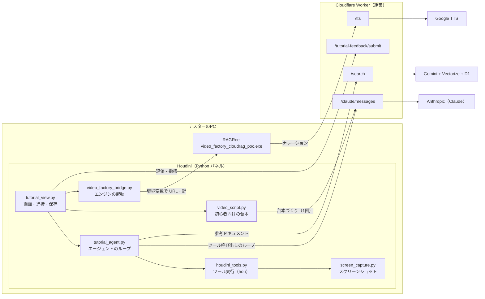
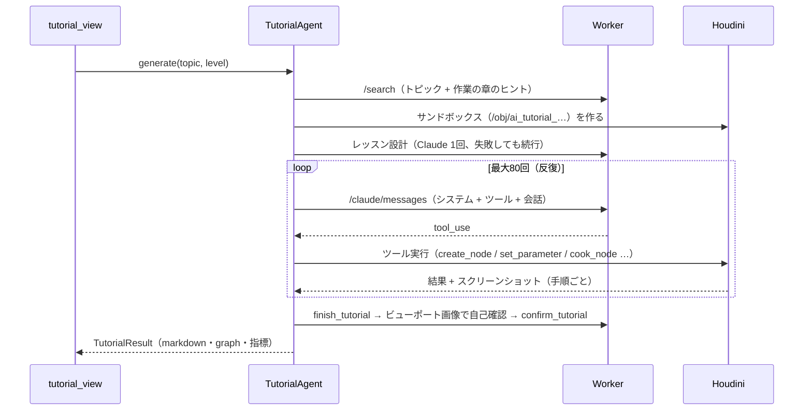
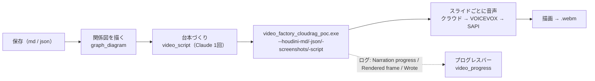

# Houdini チュートリアル生成と動画生成 — 技術解説書

**版:** 2026-10-21 ／ **対象読者:** 保守・拡張する開発者 ／ **関連:** [content-generation.md](content-generation.md)（機能の経緯）、[houdini-lesson-design.md](houdini-lesson-design.md)（レッスン設計）、[houdini-video-script.md](houdini-video-script.md)（台本）、[cloudflare-rag-technical-report.md](cloudflare-rag-technical-report.md)（サーバー側）、RAGReel の `docs/technical-reference.md`（動画エンジン）

## 1. 全体像

*図: チュートリアルと動画ができるまで。トピックを入れてから、ダッシュボードに載るまでの8段階。*

**設計の要点**

1. **Claude の鍵は、PC に置かない。** すべて Worker 経由（鍵ごとの予算を、サーバー側が強制する）。
2. **エージェントのループは、クライアント（Houdini）側。** Worker は、鍵を隠すだけの、ステートレスな中継。
3. **Houdini が真実の源。** ノードの存在・パラメータ名・cook の成否は、ドキュメントではなく、Houdini 自身が答える（`list_available_node_types` / `get_node_info` / `cook_node`）。ドキュメント（RAG）は、説明の質のためのもの。
4. **失敗しても止めない（ベストエフォート）。** レッスン設計・台本・音声・図は、どれが失敗しても、次の段階へ進み、より単純な形に落ちる。

## 2. チュートリアル生成（`tutorial_agent.py`）

### 2.1 生成の流れ

### 2.2 ツール（`houdini_tools.py`）

| ツール | 役割 |
|---|---|
| `create_node` / `delete_node` | ノードの作成・削除（サンドボックス内だけ） |
| `set_parameter` | 値・式（expression）・キーフレーム・ランプ。タプルは成分ごと |
| `connect_nodes` | 接続（`input_name` / `output_name` で名前指定できる） |
| `cook_node` | 評価。時間依存のノードは複数フレーム評価し、短いクリップも撮る |
| `inspect_geometry` | 点の数・範囲・属性・画像の値などを数値で確かめる（SOP / COP / LOP） |
| `list_available_node_types` / `get_node_info` | タイプ名・入力名・パラメータの確認 |
| `finish_tutorial` | 下書きの提出。**品質ゲート**（§3）を通る |
| `confirm_tutorial` | ビューポート画像を見て確定。**矛盾ゲート**（§3）を通る |

- **サンドボックス:** ノード操作は、`/obj/ai_tutorial_<日時>` の中だけ。ノードパスは、常にサンドボックス相対。ユーザーのシーンには触れない。
- **表示フラグ:** システムが、末端のノードに自動で付ける（モデルは、触れない）。

### 2.3 安全装置（暴走・打ち切りの扱い）

| 項目 | 値・動作 |
|---|---|
| 反復の上限 | 80回。残り5回で、仕上げを促す |
| 費用の上限（クライアント側） | $5。85%で仕上げを促す。実際の上限は、サーバーの鍵ごとの予算 |
| 1ターンの出力 | 16,000トークン（思考も数える） |
| 何も作らず終了 | 最大2回、作業開始を促す |
| `finish` 済み・`confirm` 未了で終了 | 最大2回促す。それでも無ければ、最も内容の多い下書きを、`archived`（打ち切り）として保存 |
| 拒否（`stop_reason: refusal`） | 打ち切って、理由を表示 |

### 2.4 レベル（学習の道すじ）

`basic` / `applied` / `advanced` は、**難しさではなく**、レッスン 1（「〜とは？」と最小の作り）→ 2（動かして理解）→ 3（実務の形）。名前は互換のため据え置き。前のレッスンの要約を、次の設計に渡す（`build_level_chain`）。

## 3. 品質を上げる仕組み（2026-10-20〜21）

| 仕組み | ファイル | 内容 |
|---|---|---|
| レッスン設計 | `lesson_design.py` | ノードを組む前に、章立て・確認・実験を決める（Claude 1回）。検証し、章が2つ未満なら不採用。システムプロンプトの「教え方のルール」に差し込む |
| 品質ゲート | `houdini_tools.py` + `tutorial_review.py` | `finish_tutorial` に、学ぶこと・考え方・確認ポイント・実験・仕上げ・次のレッスンが無ければ、名指しで書き足させる（最初の2回だけ） |
| 補完 | `lesson_design.fallback_fields` | 書かれなかった項目は、設計で補う。実験は「設計段階の予想」と明記 |
| 採点 | `tutorial_review.review_finish` | 10項目・100点。実験は、**実際に値を変えて再 cook した回数**も数える。指標に記録 |
| 矛盾ゲート | `houdini_tools._tool_confirm_tutorial` | `note` に「見えていません」等と書きながら `looks_correct=true` なら、最大2回差し戻す |
| 検索の章のヒント | `tutorial_agent.context_hint_for` | トピックから章（SOP が常に先頭）を決め、`/search` に渡す。除外はしない |

## 4. スクリーンショット（`screen_capture.py`）

手順（ツール呼び出し）ごとに撮り、`_screenshots.json` にまとめる（`step, tool, result, tool_result, viewport, network, network_kind, viewport_clip_frames`）。

| 画像 | 方法 | フォールバック |
|---|---|---|
| ビューポート | `flipbook`（`frameAll` してから） | なし（撮れなければ省略） |
| ネットワーク画面 | `NetworkEditor.qtScreenGeometry()` の矩形を画面から切り出す。他のウィンドウの重なり・ペインの小ささ・単色を検査 | 自前描画のネットワーク図 |
| パラメータ画面（`set_parameter`） | Parm ペインを切り出し、右に「変更点の一覧」を添える（2026-10-21） | 描き直したカード（`render_parameter_card`） |
| ノードの関係図（動画の説明スライド用） | 保存したグラフ JSON から描く（`graph_diagram.py` → `render_graph_diagram`。hou に依存しない） | なし |

- 画面の切り出しは、「いま画面に見えているもの」をコピーするため、Houdini 以外のウィンドウが手前にあると撮らない（自前描画へ）。
- 実機で確認済み: ネットワーク画面の切り出し、ビューポート。**未確認:** Parm ペインの切り出し（合成と、フォールバックのカードは、hython のオフスクリーンで確認）。

## 5. 動画生成

*図: 動画ができるまで（RAGReel）。手順書から、音声つきの WebM を作り、ダッシュボードに載せる。*

### 5.1 流れ

### 5.2 台本（`video_script.py`）

- 保存した手順書と、手順ごとのスクリーンショット一覧から、Claude が**初心者向けの台本**（JSON）を書く。コード・英字だらけ・長すぎる文は不採用。足りない手順は、**定型の解説**で補う。
- 台本の `images.node_diagram` に、関係図のパスを書く。`usage` に、使ったトークンを残す（コストの集計用）。
- 新しい節（学ぶこと・考え方・実験・仕上げ・次のレッスン）は、「前→後」「ここで〇〇が見えれば正しい」と話すルールで書き直す。

### 5.3 画像の無いスライド（2026-10-21）

説明スライドの右側が、空のグラデーションの板（ぼやけた画面）になっていた。エンジンの `assignPlaceholderImages` が、考え方・仕組み・全体の流れ・学ぶこと・つまずき → **ノードの関係図**、それ以外（実験・仕上げ等）→ **完成画像**で埋める。

### 5.4 音声

| 優先 | 経路 | 備考 |
|---|---|---|
| 1 | Worker `/tts` → Google Cloud TTS（Neural2 / Chirp 3 HD） | 鍵ごと・全体の1日の文字数の上限。同じ文章はキャッシュ。出力は、24kHz のまま受け、エンジンで 44.1kHz に |
| 2 | VOICEVOX（導入済みなら自動起動） | クレジット表記が必要 |
| 3 | Windows SAPI | 最後の砦 |

クラウドが失敗したときだけ、ローカルの音声を準備する（VOICEVOX の起動待ち最大90秒を、通常は払わない）。使われた音声は、ログの `Narration voice:` と、パネルに出る。

### 5.5 進捗（プログレスバー）

`video_progress.py`（Qt・Houdini に依存しない）が、ログから全体の％を求める。

| 段階 | ％ | 手がかり |
|---|---|---|
| 台本づくり | 0〜24 | 終わりが読めないので、時間でゆっくり進める（上限を超えない） |
| エンジンの起動・構成 | 25〜30 | `Loading…` / `Split into N slides` |
| 音声 | 30〜70 | `Narration progress: k / n`（スライドごと） |
| 描画 | 70〜98 | `Rendered frame N / M` |
| 完了 | 100 | `Wrote ….webm` |

失敗（ログに `ERROR`）は、赤で止まる。

## 6. 配布（Houdini パッケージ）

*図: 配布と、キー・予算の管理。運営が配り、鍵と予算は運営の Worker で管理する。*

`houdini/package/` と `scripts/build_houdini_package.py`。zip を展開して `install.cmd` を実行する。

- パネルの Python ファイルを `%LOCALAPPDATA%\RAGReelTutorial\python` に置き、**Houdini のパッケージ（`Documents\houdiniXX.X\packages\ragreel_tutorial.json`）**で、`PYTHONPATH` とパネル定義の場所を登録する。パネル定義（`.pypanel`）は、`import rag_chatbot` するだけの**薄い読み込み用**（ASCII のみ。Latin-1 の落とし穴を避ける）。更新は、ファイルの置き換えだけで済む。
- 設定ファイル（`~\.houdini\rag_chatbot_config.json`）に、接続先・動画エンジンの場所・保存先（`local_bridge_dir`。未設定だと保存できない）を、**既存の値を残して**書く。元の設定は、退避する。
- **確認済み:** Houdini 22（hython）が、パッケージを読み、`RAGReelTutorial` のパネル定義を認識し、`import rag_chatbot` が通る。インストール・更新・削除・複数バージョン・設定の統合は、自動テスト（PowerShell、一時フォルダ）。
- 開発者用の `deploy_panels.py`（リポジトリから、自分の Houdini へコピー）は、別に残す。**新しい `.py` を足したら、`MODULES` に追加する**（漏れると、配置されず、黙って古い動作になる。テストが検出する）。

## 7. 検証の状況

| 項目 | 状態 |
|---|---|
| Python 側の自動テスト | 91件（`uv run python -m unittest discover -s houdini/tests`）。Houdini・Claude・ネットワークを使わない |
| パネルの静的検査 | `self._xxx` の定義漏れを検出（`test_panel_static.py`）。画面コードは、Houdini 内でしか動かないため |
| Houdini 実機 | 生成・動画・音声（クラウド）は、実機で確認済み。**未確認:** Parm ペインの切り出し、チャット後のレイアウト修正（ペインの区切り）、プログレスバーの表示、パッケージ経由でのパネル表示（hython では、定義の認識まで） |
| 品質（Claude が書く設計・台本） | 実機の生成で、レッスン品質チェック 80〜92/100 を確認。**内容の正しさは、人の確認が必要** |

## 8. 既知の制限

- SOP が中心。COP・LOP・VOP・CHOP・DOP も対応。**KineFX／APEX は、SOP レベルのノードまで**（`apex::graph` の中は編集できない）。
- 煙などのボリュームは、ビューポートで枠だけに見えることがある（矛盾ゲートで差し戻すが、直せるかは実機次第）。
- 画面の切り出しは、Houdini が手前に見えていないと撮れない（自前描画に落ちる）。
- 台本・設計は AI が書く。**内容の正しさは、保証しない。**
- チャットタブ（ローカル検索用）は、配布セットでは使わない。
