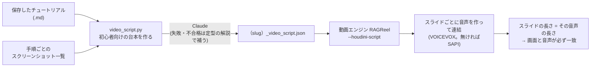

# Houdiniチュートリアル動画: 初心者向け台本と音声の改善

**作成日:** 2026-10-19
**対象:** `houdini/python_panels/video_script.py`（新規）、`tutorial_view.py`、`video_factory_bridge.py`、動画エンジン（別リポジトリ `RAGReel`）
**関連:** [content-generation.md §2.8・§2.11](content-generation.md)、RAGReelの`docs/narration-quality.md`・`docs/technical-reference.md §22`

---

## 1. 何が問題だったか（実データで確認）

保存済みのチュートリアル（`procedural-black-hole-particles_20261018`）の動画で確認した。

| # | 事実 | 影響 |
|---|---|---|
| 1 | **音声はチュートリアル本文の朗読、画面は別の文**だった。手順のスライドには、ツールの実行結果文（「…ノードを作り、名前を emit にする」）が出ていた | 画面と音声が対応せず、どちらも「操作の記録」で、初心者への説明になっていない |
| 2 | コードを入力する手順では、**コード全文**（`emit のパラメータを設定: Run Over を 0、VEXpression を int n = 30000; float rin = …`）が、画面の文章の元になっていた | 画面に出せず、読み上げもできない |
| 3 | 「ハマりポイント」「応用・発展のヒント」の節は、**専門家向けの文面のまま約110秒（動画の約35%）読み上げられていた**（`setpointattrib に float 変数を渡すと Ambiguous call エラー…`、`pow(u,3)`、`curlnoise`…） | 初心者には意味が分からない |
| 4 | スライドの長さは、文字数からの推定だった | 音声の区切りと、画面の切り替わりがずれる |
| 5 | 音声の向上（VOICEVOX）は、**導入済みでも、エンジンが起動していないと黙って従来の声（SAPI）に戻る**作りだった。どちらの声で作ったかも、どこにも出なかった | 向上が一度も効いていなかった |
| 6 | 読み替え辞書（`tts_dictionary.json`）が、**実行ファイルの隣にコピーされていなかった**。SAPIには、そもそも読み替えが無かった | 「Houdini」「VEX」「Attribute Wrangle」などの読みが崩れる |

## 2. どう直したか

*図: 動画ができるまで（RAGReel）。手順書から、音声つきの WebM を作り、ダッシュボードに載せる。*

### 2.1 台本（Houdini側）
- 保存の直後、動画を作る前に、**別スレッドで**台本を作る（Claudeの呼び出しに数十秒かかるため、UIは止まらない）。
- 台本の内容: **導入**（何を作るか・身につくこと）／**手順ごとの解説**／**全体の構成の説明**／**その他の節の言い直し**（ハマりポイント、応用のヒント）／**まとめ**（次の一歩）。
- Claudeへの指示（`video_script.py`の`SYSTEM_PROMPT`）の要点:
  - 手順ごとに、①いま何をするか ②**なぜそうするのか** ③画面で見る場所 ④つまずきやすい点、の順で書く。
  - **初めて出る用語は、その場で一言で説明する**。
  - **コードは読まない**。何をするコードかを、日常のたとえで説明する。変数名・記号・数式は読み上げない。
  - ナレーションに英字を使わない（ノード名はカタカナ）。話し言葉の「です・ます」調、1文は40文字くらいまで。
  - 与えられた手順・値・ノード名にないことは、書かない。
- **検証**（`clean_narration`）: コードのような文章、40文字未満、320文字超（文の切れ目で切れないもの）、英字が3割超の文章は、採用しない。採用しなかった手順・節は、**定型の解説**で補う（同じ説明を繰り返さず、ノード名・パラメータ名を入れる）。
- 台本が作れない（手順が無い等）ときだけ、従来の動画になる。

### 2.2 動画エンジン側
- 台本の**手順の解説・短い画面の文（最大2行）・見出し**を、各スライドに載せる。見出しは「手順 3　アトリビュートラングルノードを作る」の形。
- スライドごとに音声を作って連結し、**スライドの長さを、実際の音声の長さで決める**（手順の間に0.45秒の息継ぎ）。字幕も、同じ時刻から作る。
- 台本が無い場合は、従来どおり（本文を1回で読み、長さは文字数から推定）。

### 2.3 音声
- **VOICEVOXが応答しなければ、導入済みのエンジンを自動で起動する**（最大90秒待つ）。導入やダウンロードは、しない。
- **どの声で作ったかを必ず出す。** 動画のログに `Narration voice: VOICEVOX:春日部つむぎ(ノーマル)` を出し、Houdiniパネルの進捗にも出る。従来の声（SAPI）になったときは、「従来の音声です。VOICEVOXを起動してください」と出る。
- 辞書をexeの隣にコピーし、VOICEVOXも既定でそれを読む。Houdiniの用語47語を追加（全72語）。SAPIにも、読み替え（カタカナ化・略語の文字読み）を入れた。

## 3. 実データでの確認（ブラックホールのチュートリアル、16手順）

| 項目 | 改善前 | 改善後 |
|---|---|---|
| 音声 | 従来の声（SAPI）。本文の朗読 | VOICEVOX（春日部つむぎ）。**手順ごとの解説**。合成に約77秒 |
| 手順スライドの画面の文 | ツールの結果文・コード全文 | 短い文（例: 「Attribute Wrangle ノードを作る（名前: emit）」「emit → swirl」） |
| 「ハマりポイント」「応用のヒント」 | 専門家向けの文面を約110秒読み上げ | 初心者向けの言い直し |
| スライドの長さ | 文字数からの推定 | 音声の長さ（画面と音声が一致） |
| 同じ説明の繰り返し | — | 2回目以降は短く言う |

> **注意:** 上の「改善後」は、**Claudeに接続できないときの定型の解説**で確認したもの（この環境のAPIキーが無いため）。**Claudeが書く台本の品質は、実際に生成して確認する必要がある**（§5）。

## 4. 使い方・設定

- 通常どおり、Tutorialタブで生成 → 保存。**台本は自動で作られる**（設定は不要）。保存フォルダに `<slug>_video_script.json` が残る。
- 進捗欄の表示:
  - `動画生成: 初心者向けの台本を作っています…` → `台本: Claudeが書いた台本（16手順） / 動画生成をバックグラウンドで開始しました（初心者向け台本つき / …）` → `動画生成: フレーム N/M（P%） / 音声: VOICEVOX:春日部つむぎ(ノーマル)`
  - 台本の元が `定型の解説` のときは、その理由（「Claudeに接続できないため」等）が出る。
- 台本はそのまま**手で直せる**（JSONの`narration`・`points`・`heading`）。直したあと、エンジンを直接実行すれば、その内容で動画が作れる:
  `video_factory_cloudrag_poc.exe --houdini-md <md> --houdini-json <json> --houdini-screenshots <screenshots.json> --houdini-script <video_script.json> <トピック> <db>`
- Claudeのトークンは、チュートリアル生成と同じ**Claude予算**から引かれる（1回あたりの量は、まだ実測していない。16手順のチュートリアルで、入力・出力とも数千トークンの見込み）。

## 5. 未確認のこと

| 項目 | 状態 |
|---|---|
| Claudeが書く台本の**品質**（初心者に分かる説明になっているか） | **未確認**。検証（コード・長さ・英字）と定型の補いは入れてあるが、文章の良し悪しは、実際に生成して人が読んで判断する |
| VOICEVOXの**聴感**（声・読み） | **未確認**（機械では判断できない）。聞いて、辞書の読み（`engine/assets/tts_dictionary.json`）を直す |
| 手順ごとの音声の長さ（動画が長くなる） | 1手順あたり2〜5文の指示。長すぎる場合は、`SYSTEM_PROMPT`の文の数と`STEP_NARRATION_MAX`を調整する |
| 従来の「画面時間の比率（ノード70%・ビューポート20%・その他10%）」 | **台本つきの動画では、目標ではなく結果になる**（各手順の解説の長さで決まる）。ログの `Screen time share:` と、スライドごとの `Slide N:` の行で確認できる |

## 6. 関連して見つかった不具合（動画エンジン）

- **C++が `/EHsc` 無しでコンパイルされていた。** 例外が投げられても、局所オブジェクトのデストラクタが実行されない。VOICEVOXの自動起動で、起動直後のエンジンに対するHTTP確認がタイムアウト（例外）になったあと、次の呼び出しでクラッシュした（終了コード139）。`CMakeLists.txt`に `/EHsc` を明示して解消。`narration_tests`に、応答しないサーバーへの連続確認の回帰テストを追加した。
- 詳細は、保守ランブックの[障害記録](learning/06-maintenance-runbook.md#3-障害記録)（H・I）。

## 7. テスト

| 場所 | 内容 | 件数 |
|---|---|---|
| `houdini/tests/test_video_script.py`（`uv run python -m unittest discover -s houdini/tests`） | 台本の検証・補い・Claude失敗時・その他の節・出力ファイルの形 | 24 |
| RAGReel `narration_tests` | 読み替え辞書、手順ごとの音声の連結・時刻、HTTP確認の回帰 | 33 |
| RAGReel `script_composer_tests` | 台本の読み込み・スライドへの反映・コードを読まない保証・節 | 25 |

## 8. 2026-10-21の追加: ぼやけた画面の解消、パラメータの実画面、チャットのレイアウト崩れ

### 8.1 説明スライドの「ぼやけた画面」をなくした

動画の説明スライド（学ぶこと・考え方・つまずきやすい点・もっと試してみよう等）は、画像を持たず、右側が**空のグラデーションの板**になっていた。次のように直した。

| スライド | 出す画像 |
|---|---|
| 考え方・仕組み・全体の流れ・学ぶこと・つまずきやすい点 | **ノードの関係図**（保存したグラフから描く。`graph_diagram.py` → `screen_capture.render_graph_diagram`） |
| 実験・仕上げ・もっと試してみよう・その他 | **完成画像**（最後に撮ったビューポート） |
| 片方しか無いとき | あるほうを使う |
| どちらも無いとき | 従来どおり（変更なし） |

- 関係図は、サンドボックスが消えたあとでも描ける（hou を読まない）。直下のノードが2つ以上ある**浅い**ネットワークを選ぶ（APEXなどのサブネット内部の数十ノードは選ばない）。
- 台本に `"images": {"node_diagram": "<PNG>"}` を書き、動画エンジンが `assignPlaceholderImages` で割り当てる。
- 確認: ブラックホールのチュートリアルで、動画を実際に作り、「つまずきやすいところ」にノード図、「もっと試してみよう」に完成画像が出ることを確認した。

### 8.2 パラメータ画面を、実画面で見せる（撮れなければ従来のカード）

`set_parameter` のステップは、Houdiniの**実際のパラメータ画面**（Parmペイン）を切り出して左に大きく出し、右に「何を、いくつからいくつに変えたか」の一覧を添える。

- ノードを選択してペインに表示させ、`qtScreenGeometry()` の矩形を画面から切り出す（ネットワーク画面と同じ方法。他のウィンドウが重なる・ペインが小さい・ピン留め・撮れない等のときは使わない）。
- 撮れなければ、従来の「描き直したカード」になる。どちらを使ったかは `capture.log` の `parameter capture method:` に残る。
- **限界:** 変えたパラメータが、ペインのスクロールや折りたたみで見えていないことがある。そのため右の一覧を必ず添える。
- 確認: 合成の画面と、フォールバックのカードは、hython（オフスクリーン）で描いて確認した。**実機のペインの切り出しは未確認**。

### 8.3 チャットのあとにレイアウトが崩れる不具合

チャットの回答のあと、画面下の「参照: タイトル, タイトル, …」が1行で長く出て、ラベルの最小幅がペインより広くなり、パネルがペインからはみ出して、区切り（比率）が動かせなくなっていた。

- 折り返さないラベルは、水平方向の大きさを中身の長さと切り離す（`tame_label_widths`）。
- 参照の表示は120文字で省略し、全文はツールチップに出す。
