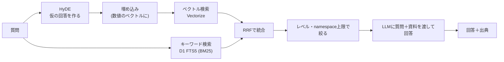
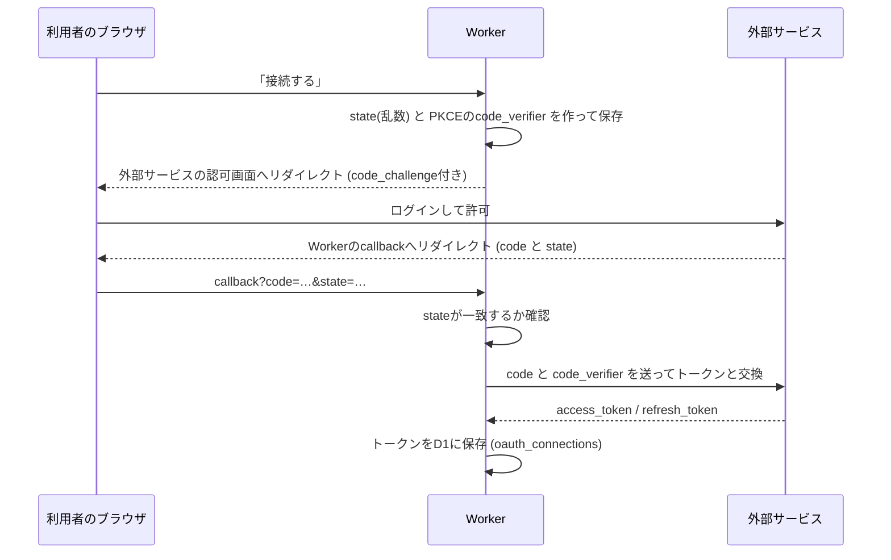

# 03. 専門編

**更新日:** 2026-10-17　**目安:** 1〜2週間（必要な章だけでよい）　**前提:** [02. 基礎編](02-fundamentals.md)
**ゴール:** このプロジェクトの**核になる技術を、原理から説明できる**。「なぜそう作ってあるか」が分かる。

章ごとに独立している。目的別の読み方は[README.md](README.md)を参照。

---

## 1. RAGの原理

### 1.1 なぜRAGか

LLM（大規模言語モデル）は、学習した範囲しか知らず、自分の資料の中身を知らない。**質問に関係する資料を先に検索して、質問と一緒にLLMへ渡す**のがRAG（Retrieval-Augmented Generation）。資料が更新されても、LLMを学習し直さずに済む。



実装: [`src/retrieve.ts`](../../cloudflare-rag-poc/src/retrieve.ts)（流れ）、[`src/hybrid.ts`](../../cloudflare-rag-poc/src/hybrid.ts)（検索と統合）、[`src/embeddings.ts`](../../cloudflare-rag-poc/src/embeddings.ts)（Gemini呼び出し）、[`src/query.ts`](../../cloudflare-rag-poc/src/query.ts)（全体）。

### 1.2 埋め込み（embedding）とベクトル検索

- **埋め込み:** 文章を、意味が近いほど近くなる数値の並び（このプロジェクトでは768個）にしたもの。
- **近さの測り方:** コサイン類似度（2つのベクトルの向きの近さ）。Vectorizeのインデックスは`768次元・cosine`で作る。
- **注意:** 質問と資料は、**同じ埋め込みモデル**で作る。モデルを変えたら、すべて作り直し。
- 長所: 言い回しが違っても、意味が近ければ見つかる。短所: 型番・固有名詞・数字の完全一致に弱い。

### 1.3 キーワード検索（BM25）とFTS5、そして日本語

- **BM25:** 「その語が、その文書に多く出て、全体では珍しいほど高い点」を付ける、古典的な検索の点数。
- **FTS5:** SQLiteの全文検索機能。`chunks_fts`がそれ。
- **日本語は、単語の区切りが無い**ので、標準のトークナイザでは検索できない。そこで**trigram**（3文字ずつの断片で索引を作る）を使う。**3文字未満の語は、検索にかからない**ことに注意。
- `MATCH`には構文（`"`、`:`、`-`、`AND`、`OR`など）がある。質問文をそのまま渡すと構文エラーになるため、`escapeFtsQuery`が、語ごとに引用符で囲んで無害化している（実際に起きた不具合）。

### 1.4 RRF（Reciprocal Rank Fusion）

ベクトル検索とキーワード検索の**点数は、単位が違って比べられない**。そこで**順位だけ**を使って統合する。

```
各検索での順位 r（0始まり）について、 1 / (60 + r + 1) を足し合わせる
```

- 両方の検索で上位に出たものが、最も高くなる。定数60は、一般的な既定値。
- RRFの点の**絶対値に意味は無い**（小さな値）。画面には、その回答の中での相対値として扱う。

### 1.5 HyDE

質問そのものではなく、**LLMに「こう答えるだろう」という短い仮の回答を作らせ、それを埋め込む**。質問文と資料の言葉の食い違いを、小さくできる。**仮の回答も、トークン（費用）を使う**。

### 1.6 チャンク分割

長い文章は、**検索しやすい大きさに切る**（`chunkText`: 1,000文字、前後150文字を重ねる）。重ねるのは、境界で文脈が切れないようにするため。大きすぎると、関係ない部分が混ざる。小さすぎると、前後の文脈が失われる。

### 1.7 出典と、答えの信頼性

- 回答の`[1]`のような番号は、渡した資料への参照。**引用率**（引用された資料の割合）が低いと、資料が使われずに、LLMが自分の知識で答えた可能性がある。
- **鮮度:** 資料の登録日時を出し、古いものに注意を促す（180日以上前は「古い可能性」）。
- **答えられなかった質問**を集計して、足りない資料を見つける（管理画面の「利用状況・コスト」）。

### 練習
1. `hybrid.ts`の`rrfMerge`に、リストA=[x,y,z]、リストB=[y,x,w]を渡す。結果の順位を、手計算で出す。
2. 「SOPとは」という質問で、無関係な資料が混ざった。どの層（検索対象の絞り込み／namespace上限／埋め込み）で対策できるか。（→ 運用手順書§4）
3. 2文字の語「光源」だけで検索すると、キーワード検索はどうなるか。理由は。

**ヒント:** 1は、xはAで0位・Bで1位、yはAで1位・Bで0位。2は、`ns-chips`と`result_limit`。3は、trigram。

## 2. LLMのAPIとtool use（function calling）

### 2.1 メッセージのやりとり

LLMのAPIは、**会話の履歴を毎回丸ごと送る**（サーバーは覚えていない）。`system`（役割の指示）＋`messages`（ユーザーと助手のやりとり）＋`tools`（使える道具の定義）を送る。

### 2.2 tool useのループ

LLMは、道具を**自分では実行できない**。「この道具を、この引数で使いたい」と**返す**だけ。実行は、こちら側。

```
messages = [ユーザーの依頼]
loop 最大80回:
    応答 = LLM(messages, tools)
    もし 応答が道具の使用 (tool_use) を含む:
        各 tool_use について 結果 = こちらで実行する
        messages に 応答 と tool_result(結果) を追加
        続ける
    それ以外（文章だけ）:
        終了
```

実装: [`tutorial_agent.py`](../../houdini/python_panels/tutorial_agent.py)の`for iteration in range(1, MAX_ITERATIONS + 1)`。道具の定義は`houdini_tools.py`の`HOUDINI_TOOLS`、実行は`HoudiniToolExecutor.execute`。

**設計の要点（このプロジェクトで実際に効いたこと）**
- **道具のエラーも、結果として返す。** 例外で止めず、`エラー: …`を`tool_result`に入れる。LLMがそれを読んで、自分で直す。
- **終わらせる道具**（`finish_tutorial`・`confirm_tutorial`）を用意する。LLMが「終わった」と言うだけでなく、検証を通す。
- **上限を2つ持つ。** 反復の上限（80回）と、費用の上限。無限ループを防ぐ。
- **サンドボックス。** 生成用のノードは、専用の場所の下だけで操作させる。外はエラーにする（`SandboxViolation`）。
- **画像を結果に添付する。** スクリーンショットを`tool_result`に入れ、LLMが見た目で確かめられるようにする。

### 2.3 費用とトークン

- 料金は**入力トークン＋出力トークン**。日本語は、英語より、同じ内容でトークンが多くなりやすい。
- **プロンプトキャッシュ:** 毎回同じ前半部分（システム指示・道具定義・RAGの資料）は、キャッシュに載せると、2回目以降が安くなる。`cache_control`で指定する。
- このプロジェクトは、**APIキーごとのトークン予算**を、サーバー側（`budget.ts`）で強制する。クライアントに、Claudeの鍵は渡さない（`/claude/messages`の中継）。

### 2.4 ストリーミング（SSE）

回答を、生成されたそばから送る方式。Server-Sent Events（サーバーから、イベントを順に流す）。`/query/stream`が、出典を先に、回答を後から送る。**ツールを使う質問は、従来どおり一括**で返す。

### 練習
1. `tutorial_agent.py`を読み、「反復の上限に達した」ときの処理を探す。
2. tool useで、道具の実行結果が`is_error=True`のとき、LLMはどうふるまうか。なぜ、例外で止めないのか。
3. `query.ts`の`prepareQuery`と`finishQuery`は、なぜ分かれているのか。（ストリーミング版と一括版の両方から使われる）

## 3. 認証・認可・OAuth

### 3.1 このプロジェクトの認証

- **APIキー:** `Authorization: Bearer <キー>`。**サーバーには、キーのSHA-256ハッシュだけ**を保存する（`users.user_id`）。DBが漏れても、元のキーは分からない。
- **ロール:** `admin`（すべて）／`editor`（ナレッジ登録・同期の実行と履歴の閲覧）／`member`（チャット・グラフ・履歴の利用）／`guest`（制限つきの利用。連携やSlackは使えない）。判定は`requireAdmin`と`requireKnowledgeEditor`（`auth.ts`）。
- **namespaceの許可（`key_namespace_grants`）:** キーごとに、見られる共有namespaceを絞る。個人用（`personal:<userId>`）は、本人だけ。
- **認可の落とし穴:** 「権限のあるユーザー」だけでなく、「その**対象**（namespace・文書）に対する権限」も確認する。`assertOwnNamespaceOrShared`は、他人の個人用の領域に書き込めないようにする。

### 3.2 OAuth 2.0（Authorization Code ＋ PKCE）

「パスワードを渡さずに、他のサービス（Jira・Google・Slack）の操作を、許可してもらう」仕組み。



- **state:** 他人が作った認可を、自分のものとして処理させない（CSRF）ための乱数。
- **PKCE:** 認可コードが途中で盗まれても、`code_verifier`を知らないと使えないようにする。
- **access_token:** 短命。**refresh_token:** 新しいaccess_tokenを得るための長命の鍵。**どちらも、ログやエラーに出さない。**
- **連携の持ち主（`owner_id`）:** 共有（空）か、個人（ユーザーID）。個人用の連携は、本人の索引にだけ入る。
- 実装: `oauthConnections.ts`（保存）、`*OAuth.ts`（各サービス）、`mcp/auth.ts`（公式MCPの自動登録＝DCR）。

### 3.3 署名による認証（Slack）

Slackからのリクエストは、APIキーではなく**HMAC署名**で確かめる。`署名 = HMAC-SHA256(secret, "v0:" + 時刻 + ":" + 本文)`。**時刻が5分以上ずれたら拒否**（使い回しの防止）。比較は、**定数時間**で行う（処理時間から、署名を推測されないため）。実装: `slackBot.ts`。

### 練習
1. `auth.ts`の`authenticate`を読み、APIキーから、ユーザーを見つけるまでの流れを書く。
2. OAuthのcallbackで、`state`を確認しないと、どんな攻撃が可能になるか。
3. `slackBot.ts`の`verifySlackSignature`と`safeEqual`を読み、なぜ`===`で比較しないのか説明する。

## 4. MCP（Model Context Protocol）

AIが外部の道具・データを使うための**共通の規格**。JSON-RPC（JSONで「関数を呼ぶ」やりとり）の上に作られている。

- **サーバー**が道具（`tools/list`で一覧、`tools/call`で実行）を公開する。**クライアント**（AIを使う側）がそれを呼ぶ。
- このプロジェクトでは、**Workerが、公式MCPサーバー（GitHub・Slack・Google・Linear・Sentry・Figma・Notion・Atlassianなど）に接続するクライアント**になる（`src/mcp/`）。RAGの検索で足りないとき、**読み取り専用の道具だけ**を使って調べる。
- 安全策: ツールは、管理者が選んだものだけ。チャットで使えるのは読み取り専用のものだけで、判定は`permissions.ts`が行う（読み取り専用と確認できないものは「書き込みかもしれない」として扱う）。引数は監査ログに保存しない。
- ほかに、ローカルRAGを**MCPサーバーとして公開**するもの（`scripts/rag_mcp_server.py`）がある。

関連: [mcp-client.md](../../cloudflare-rag-poc/docs/mcp-client.md)

### 練習
1. `src/mcp/protocol.ts`を読み、`tools/list`と`tools/call`のリクエストの形を書く。
2. 道具が「読み取り専用」かどうかを決める優先順位を、`permissions.ts`の冒頭コメントから書き出す。

## 5. Cloudflare特有の制約と回避策

このプロジェクトの設計の多くは、**Workersの制約への対処**。制約を知ると、設計の理由が分かる。

| 制約（2026-10時点・無料枠。**最新は公式で確認**） | 実際に起きたこと | 対処（設計） |
|---|---|---|
| 1リクエストの**CPU時間**が短い | 重い同期で`Error 1102` | 1回の呼び出しで少しだけ処理し、**続きは呼び直す**（バッチ＋`opId`で再開） |
| 外部呼び出し（サブリクエスト）の**回数上限** | 大量のページで失敗 | バッチサイズを下げる（既定1〜5件） |
| **メモリ128MB** | 大きいファイルで失敗 | ファイル全体を読まず、必要な部分だけ取得（DOCX/PPTXはHTTP Range） |
| 1回のリクエストが**長い**と、途中で切られる | `Unexpected token '<'` | 25秒の予算で打ち切り、残りは次のリクエスト |
| 1ページの**登録量**が多すぎる | 再クロールが503（2026-10-17。1ページの9割がサイドバーの目次で、約200チャンク） | 本文（`<main>`）だけを登録。1ページ10万文字で頭打ち |
| **D1の読み取り行数**（1日） | 2026-10-16、全APIが500 | 全件走査を避ける（下記） |
| **FTS5のUNINDEXED列**で探すと全件走査 | グラフ表示で、日次枠の9割を消費（2026-08） | `kb_documents`、`chunk_rows`の対応表 |

### 5.1 「バッチ＋再開」のパターン

```
開始: ジョブ(opId)を作る → 先頭からN件処理 → 位置を保存 → 「続きがある」と返す
クライアント: nextIndex が null になるまで、同じ操作を繰り返し呼ぶ
途中で止まっても、保存した位置から再開できる
```

- 失敗は**そのページだけ**を「エラー」にして、次へ進む（1件の失敗で全体を止めない）。
- **変更が無いページは飛ばす**（本文のハッシュ`crawl_page_hashes`を比べる）。再クロールが軽くなる。
- 実装: `urlImport.ts`（`runCrawlBatch`）、`crawlSchedules.ts`（定期実行のCron）。

### 5.2 D1の読み取り行数を増やす原因（3つ）

1. **索引の無い列での検索**（`SCAN`）。→ `EXPLAIN QUERY PLAN`で確認。
2. **同じ集計を、画面を開くたびに実行する。** → 結果を一定時間キャッシュ（`stats_cache`）。
3. **「新しい順に20件」でも、索引が無いと全件を読んで並べ替える。** → `ORDER BY`の列に索引（`kb_log(created_at)`）。

**調べ方:** `wrangler d1 insights rag-poc-db --timePeriod 1d`で、**どのSQLが何行読んだか**の一覧が出る（[06 保守ランブック](06-maintenance-runbook.md)の記録も参照）。

### 練習
1. `migrations/0030_chunk_rows.sql`と`src/chunkRows.ts`を読み、なぜ「`chunks_fts`に挿入した直後の`last_insert_rowid()`」を使うのか、説明する。（ヒント: FTS5はrowidでの参照だけが速い）
2. `chunkRows.ts`の`runStatementGroups`は、なぜ「グループを分割しない」のか。
3. 無料枠を使い切ったとき、ユーザーに見える症状を、3つ書く。

## 6. 取り込みの流れ（ナレッジ登録）

```
取得（Notion/Drive/URL/…）→ テキスト化 → チャンク分割 → 埋め込み(Gemini) →
  Vectorize へ登録 ＋ D1（chunks_fts / chunk_rows / kb_documents）へ登録 → 履歴（kb_log / kb_ops）
```

- **チャンクID:** `ハッシュ(namespace::file):番号`。同じ文書を再登録すると、同じIDで**置き換わる**（重複しない）。IDに日本語をそのまま使わないのは、Vectorizeの64バイト上限のため。
- **短くなった文書:** 前回のチャンク数を覚えておき、増えなかった分の古いチャンクを消す。
- **取り消し（ロールバック）:** `opId`単位で、D1とVectorizeの両方から消す。**生のテキストは保存していない**ので、必要なら再同期する。
- **安全策:** 連携の同期先は**許可リストに入れたnamespaceだけ**。自動同期は**明示的にオンにしたものだけ**。同期前に**プレビュー**で内容を確認する。**ステージング**（受け皿namespace）で確認してから本番へ移す。

実装: `kbIngest.ts`（核）、`syncTargets.ts`（認可）、`staging.ts`、`kbRollback.ts`。詳細は[sync-governance.md](../../cloudflare-rag-poc/docs/sync-governance.md)。

## 7. Houdini

### 7.1 `hou`モジュール

HoudiniのPython API。ノード・パラメータ・ジオメトリを操作する。

| やること | 例 |
|---|---|
| ノードを作る | `parent.createNode("box", "my_box")` |
| パラメータを設定 | `node.parm("sizex").set(2.0)`、式は`setExpression("sin($F)")` |
| つなぐ | `node.setInput(0, other)` |
| 評価（cook） | `node.cook(force=True)` |
| ジオメトリを調べる | `node.geometry().points()`、`geo.attribs()` |
| ネットワークの種類 | SOP（形）、COP（画像）、LOP（USD）、VOP（シェーダ）、CHOP、DOP、TOP |

- **cookエラーの有無**が、チュートリアル生成の合格条件の1つ。
- **KineFX／APEX**（リグ）は、SOPレベルのノードまでが対象。`apex::graph`の中身は、今のツールでは編集できない。

### 7.2 スレッドの制約（重要）

`hou`の操作は、**Houdiniのメインスレッド（UIのスレッド）**で行わないと、不安定になる。一方、生成中にUIを固めたくないので、**生成は`QThread`（別スレッド）**で動かす。

→ `houdini_tools.py`の`_run_in_main_thread`が、`hdefereval.executeInMainThreadWithResult`で、`hou`の操作だけをメインスレッドに送っている。**ツールを足すときも、この経路を通る**（`execute`が自動で通す）。

### 7.3 Python Panel と PySide6

- Houdiniの画面にパネルを出す仕組み。UIは**PySide6（Qt）**。
- Python Panelは、コードを**文字列として実行**するため、`__file__`が未定義になる。`rag_chatbot.py`は、`hou.homeHoudiniDirectory()`から探して`sys.path`に足している。（→ 配布の整理: [distribution-strategy.md §5](../distribution-strategy.md)）
- **配置先に注意:** 実機は`Documents/houdini21.0/python_panels`の手動コピーを読む。**リポジトリを直しても、実機には反映されない。**

### 練習
1. `houdini_tools.py`の`_tool_create_node`（871行付近）を読み、`SandboxViolation`が出る条件を探す。
2. `HOUDINI_TOOLS`の1つ（例: `set_parameter`）の定義と、対応する`_tool_set_parameter`の対応を、表にする。
3. 新しい道具を足すとき、**変更が必要な場所**を、3つ挙げる。（→ [04 応用編](04-applied.md#レシピd-houdiniの道具を足す)）

## 8. Unity

- エディタ拡張のウィンドウ（`RAGChatbotWindow`）は、`IRAGClient`を通して通信する。**Cloud/Localの切り替えは、設定だけ**。
- 通信はHTTP＋JSON。認証は、他のクライアントと同じBearerキー。
- 保守の焦点: **APIの契約が変わったら、C#の型（`RAGMessage`、`RAGGraphData`）も合わせる**。→ [architecture-layering-plan.md §6](../architecture-layering-plan.md)

## 確認

- [README.md](README.md)の「専門」のチェック4項目に、答えられる。
- 白紙に、検索の流れ・OAuthの流れ・tool useのループを、何も見ずに描ける。
