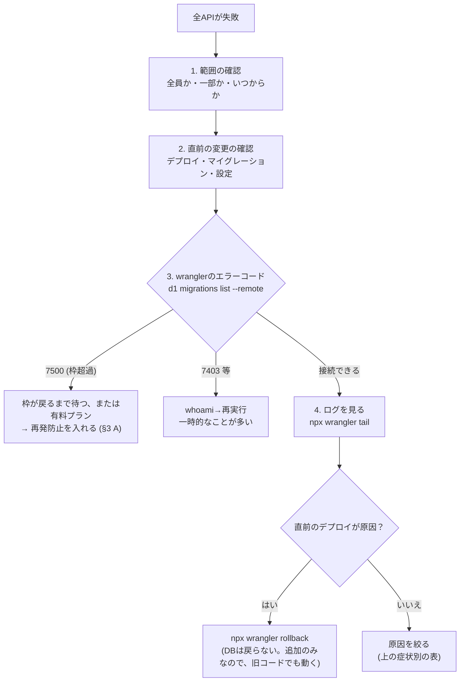

# 06. 保守ランブック

**更新日:** 2026-10-17　**使い方:** 通読する資料ではなく、**困ったときに引く資料**。
**前提:** [05. Script編](05-scripts.md)の`wrangler`の節。コマンドは、すべて`cloudflare-rag-poc/`で実行。

---

## 1. 定期点検

### 毎日（1分。画面で）
- [ ] 管理 → Overview：エラー数・予算の残りが、異常でないか
- [ ] 管理 → ナレッジ登録 →「同期履歴」：状態が`error`のものが増えていないか（日次の自動同期は、日本時間13時台に動く）

### 毎週（10分）
- [ ] 管理 → 利用状況・コスト：Gemini・Claudeの推定コストが、想定内か
- [ ] 管理 → 利用状況・コスト：「答えられなかった質問」を見て、足りない資料を登録する
- [ ] 連携の「接続状態」：期限切れ（要再認証）が出ていないか
- [ ] `npx wrangler d1 insights rag-poc-db --timePeriod 7d`：**読み取り行数が突出したSQLが無いか**（[§3の障害記録](#3-障害記録)）

### 毎月（30分）
- [ ] 管理 → システム →「設定バックアップ」をエクスポートし、保管する
- [ ] 使っていないAPIキー（最終利用が古い）の失効
- [ ] 依存の更新確認（`npm outdated`、`uv lock --upgrade`は**実行前に差分を確認**）
- [ ] 外部サービスの仕様変更（Gemini・Cloudflare・各OAuth）のお知らせ確認。**モデル名の廃止**に注意（`gemini-flash-latest`のような別名は、影響を受けにくい）
- [ ] この資料群の更新（新しい障害の記録を足す）

## 2. 症状別の切り分け

**最初にやること（どの症状でも）:** ①**いつから**か ②**何をしたら**か ③**自分だけか、全員か** ④**直前に変更したか**（デプロイ・マイグレーション・設定）。

| 症状 | まず疑うこと | 確認 | 詳しくは |
|---|---|---|---|
| **全部のAPIが500**（認証も） | **D1の読み取り枠の超過** | `npx wrangler d1 migrations list rag-poc-db --remote`で、`code: 7500`が出るか | [§3 A](#3-障害記録) |
| 画面に「応答がJSONではありません」 | サーバーが落ちた、または処理が長すぎた | ブラウザのNetworkタブでステータスを見る | [01 §2.2](01-common-knowledge.md#22-応答がjsonではありませんの正体) |
| 401（認証に失敗） | APIキーの誤り・失効・期限切れ | 管理 → ユーザー・権限で、期限を確認 | |
| 403（権限がありません） | ロール不足、namespaceの許可が無い | ロールと、許可namespaceの確認 | 運用手順書§3 |
| 429（予算・レート制限） | トークン予算の枯渇、30回/分の超過 | 利用状況・コスト | 運用手順書§9 |
| 検索が常に**0件** | Vectorizeの**メタデータインデックス**が、データ投入前に作られていない | セットアップ手順D | 運用手順書§1 |
| 検索が`fts5: syntax error` | 検索語の特殊記号（`-` `:` `"`など） | `hybrid.ts`の`escapeFtsQuery` | [§3 D](#3-障害記録) |
| 同期が途中で止まる／`Error 1102` | CPU時間・サブリクエスト数の制限 | バッチサイズを下げる | [03 §5](03-specialized.md#5-cloudflare特有の制約と回避策) |
| 同期結果が空・古い | 同期元の設定ミス、OAuth期限切れ、許可リスト外 | 「接続テスト」「プレビュー」。許可リストの確認 | sync-governance.md |
| 通知（Slack・Gmail）が来ない | 通知先の設定 | 管理 → ナレッジ登録 → Slack連携の欄の「テスト通知を送信」 | 運用手順書§5 |
| 画面が崩れる・ボタンが効かない | `chatUi.ts`のテンプレート文字列の記号 | ブラウザのConsoleのエラー | [04 レシピE](04-applied.md#レシピe-管理画面にカードを足す) |
| Houdiniで、修正が反映されない | 実機は、**別の場所のコピー**を読んでいる | `Documents/houdini21.0/python_panels`の更新日時 | [03 §7.3](03-specialized.md#73-python-panel-と-pyside6) |
| Houdiniの生成が、途中で止まる | 反復の上限、予算、費用の上限、cookエラー | パネルの進行ログ、`abort_reason` | |
| wranglerが`7403`で失敗 | 一時的なAPIエラーのことが多い | `npx wrangler whoami`→再実行 | 運用手順書§8-3 |

## 3. 障害記録

**書き方（新しい障害のたびに足す）:** ①いつ ②症状 ③原因 ④見つけ方 ⑤復旧 ⑥再発防止 ⑦学び。

### A. 2026-10-16　D1の読み取り枠を使い切り、全APIが500

| 項目 | 内容 |
|---|---|
| **症状** | チャット画面で「認証に失敗しました: 応答がJSONではありません…HTTP 500」。Consoleに405と500が複数。コードの変更は無い |
| **原因** | D1の無料枠（1日の読み取り行数）を超過。**`wrangler`の応答が`code: 7500`（`exceeded D1's free tier daily row read limit`）**。認証も、D1を読むため、全部が失敗した |
| **見つけ方** | `npx wrangler d1 insights rag-poc-db --timePeriod 1d`。**読み取り行数の合計が、ほぼ1つのSQLに集中**していた（下表） |
| **復旧** | ①UTC 0時（日本時間9時）に枠が戻る、または有料プランにする。②下記の再発防止を入れる。**復旧前は、マイグレーションもデプロイも、D1を使うので失敗する** |
| **復旧の記録** | 2026-10-17 UTC 3時台に枠が戻ったことを確認 → 未適用のマイグレーション（0022〜0030）を、一覧と中身を読んでから適用 → 表・列の存在と`chunk_rows`の一致（14,586件）を確認 → デプロイ → 疎通確認。以後の1日の読み取りは、約3.9万行（障害時は約500万行） |

見つかった内訳（1日分）:

| SQL | 1回あたりの読み取り行数 | 実行回数 | 合計 |
|---|---:|---:|---:|
| `SELECT namespace, COUNT(DISTINCT file), COUNT(*) FROM chunks_fts GROUP BY namespace`（管理画面のnamespace別集計） | 約29,000 | 149 | **約435万** |
| `SELECT * FROM kb_log ORDER BY created_at DESC LIMIT ?`（同期履歴） | 約4,400 | 145 | 約63万 |

**再発防止（実施済み）**
1. namespace別の集計を、`stats_cache`に**10分キャッシュ**（migrations/0029）
2. 集計の元を、`chunks_fts`から、**対応表`chunk_rows`**に変更（migrations/0030）
3. `kb_log(created_at)`に**索引**（0029）
4. クロールの重複確認を、`chunks_fts`ではなく`kb_documents`（索引つき）に変更
5. `chunks_fts`を`chunk_id`・`namespace`・`file`で探す・消す処理を、すべて**rowid経由**（`chunk_rows`）に変更

**学び**
- **復旧の手順は、「一覧で確認 → 中身を読む → 適用 → 確認 → デプロイ → 疎通確認」。**
- **「全部が壊れた」＋「コードの変更が無い」→ 上限を疑う。** エラーメッセージの`code`を読む。
- **調べる操作も、読み取り枠を使う。** 枠が尽きかけているときに、大きな`SELECT`を打たない。
- **全件走査は、少ない呼び出しでも積もる**（1回約3万行×150回で、枠の9割）。画面を開くたびに走る集計は、特に危険。
- **マイグレーションを先に適用し、デプロイは後**。枠が尽きている間は、どちらもできない。
- **`echo y |`で確認を飛ばして、本番に適用しない。**

### B. 2026-08-29　グラフ表示がD1の日次枠の9割を消費
- **原因:** `chunks_fts`の`UNINDEXED`列に、先頭が不定の`LIKE '%:0'`をかけ、グラフを開くたびに全チャンクを走査。
- **対処:** 1ドキュメント1行の`kb_documents`を新設（migrations/0008）。
- **学び:** `UNINDEXED`列は、検索の条件にしない。要約・対応表を作る。

### C. 検索が常に0件（メタデータインデックスの作り忘れ）
- **原因:** Vectorizeの**メタデータインデックス**を、データ投入の**前**に作っていなかった。後から作っても、既に入れたデータには効かない。
- **対処:** セットアップ手順（運用手順書§1）の順序を守る。

### D. 2026-09-04　検索語の記号でFTS5が構文エラー
- **症状:** 「`-f`フラグの直し方」「比率: 3:1」のような、ごく普通の質問で検索全体が失敗（`fts5: syntax error`）。
- **原因:** FTS5の`MATCH`は、`-`・`:`・`"`などに構文上の意味があり、質問文をそのまま渡していた。
- **対処:** 語ごとに引用符で囲んで無害化（`escapeFtsQuery`）。

### E. 同期中の`Unexpected token '<'`／`Error 1102`
- **原因:** 1回の同期処理が長すぎて、プロキシが打ち切った（HTMLのエラーページが返る）、またはWorkerのCPU時間を超過した。
- **対処:** バッチサイズを下げる（既定1〜5）。25秒の予算で打ち切って続きを呼び直す設計に。
- **関連:** 無料プランでは、CPU時間の上限を引き上げられない（`limits.cpu_ms`は有料プランのみ）。

### F. サービスアカウントのキーが作れない（GCPの組織ポリシー）
- **原因:** 組織ポリシー`iam.disableServiceAccountKeyCreation`。
- **対処:** 個人アカウントのOAuthリフレッシュトークン方式に変更。詳細は[cloudflare-rag-technical-report.md §8](../cloudflare-rag-technical-report.md)。

### G. 2026-10-17　再クロールが503で止まる（ページの9割がサイドバーの目次）
| 項目 | 内容 |
|---|---|
| **症状** | 管理 → ナレッジ登録 → URLのクロールで、`POST /admin/kb/crawl-url`が503（Service Unavailable）。画面は「登録中です…」のまま。中断中のジョブ（`crawl_jobs`）は、14ページ処理した時点で止まり、あと約790ページが残っていた |
| **原因** | ドキュメントサイトの各ページ（SideFXは1ページ約90万バイト）は、**全ノードの一覧のサイドバー（約9.5万文字）**を持つ。本文（`<main>`）は約1万文字。目次ごと登録していたため、**1ページ約200チャンク**（本文だけなら約17）になり、埋め込み・Vectorize・D1書き込みの回数が約10倍になった。当日のD1書き込みの改修（チャンクあたり2文→4文）が重なり、1リクエストの処理がCloudflareの上限を超えて打ち切られた（HTMLの503）。ただし、Workerのログで直接確認できたわけではない（推定） |
| **見つけ方** | ①`wrangler d1 execute`で`crawl_jobs`の次のURLを調べ、②そのページを`curl`で取得して、本文とナビの文字数の内訳を計測（`<main>`の外が約90%） |
| **復旧** | 本文抽出を修正（下記）して、デプロイ。止まっていたジョブは、管理画面の「中断したクロール」から「続きから再開」できる |

**再発防止（実施済み）**
1. 本文は`<main>`・`<article>`・`role="main"`の中だけを取る。どのページでも、`<nav>`・`<footer>`・`<aside>`・`<noscript>`の中の文字は、本文に入れない。**リンクは、目次からのものも含め、ページ全体から集める**（クロールで辿るため）（`src/urlImport.ts`の`extractTextLinksAndTitle`）
2. 本文の領域が完全に空のページ（JavaScriptで描くページなど）だけ、領域の絞り込みをやめて取り直す
3. 1ページから登録する本文を、10万文字（約118チャンク）で頭打ちにする（保険）
4. テスト`test/extract.test.mjs`を追加（実ページの構造を模した、目次入りのページ）。テスト用の`HTMLRewriter`の代用品を、入れ子・終了タグを扱える形に作り直した（`test/helpers/htmlRewriterShim.mjs`）

**効果（実ページで計測）:** 抽出文字数 約16.9万 → 約1.4万、チャンク 約199 → 17、リンク 約1,200本は維持。

**学び**
- **ドキュメントサイトは、本文より目次の方が大きいことがある。** クロールの対象サイトの1ページを、先に取得して、本文とナビの内訳を測る。
- **目次を登録すると、コストだけでなく、検索の質も落ちる**（全ページに同じ文が入る）。
- **「直前に入れた改修」と「前から潜んでいた弱点」が重なると、突然壊れる。** 本番のログ（`wrangler tail`）が取れない障害では、実データ（`crawl_jobs`、対象ページ）から、再現に必要な数字を測る。

### H. 2026-10-19　動画の音声が良くならない（導入済みのVOICEVOXが、黙って使われていなかった）
| 項目 | 内容 |
|---|---|
| **症状** | 動画の音声に、VOICEVOXへの切り替えの効果が感じられない。ナレーションも、解説ではなく読み上げに聞こえる |
| **原因** | ①VOICEVOXは導入済みだが、**エンジンが起動していないと、黙って従来の声（SAPI）に戻る**作りだった。②**どちらの声で作ったか**が、どこにも出なかった。③読み替え辞書が**exeの隣にコピーされておらず**、SAPIには読み替え自体が無かった。④台本は、チュートリアル本文の朗読で、画面の文はツールの結果文だった |
| **見つけ方** | `http://127.0.0.1:50021/version` が応答しない／`Programs\VOICEVOX` には実体がある。動画のログに音声の種類の行が無い。`build/engine/assets/` に辞書が無い。章ごとの時間と文章を、メタデータ（`metadata.json`）から出して、読み上げられている文を確認 |
| **対策** | 導入済みVOICEVOXの自動起動、使った声のログ・画面への表示、辞書のコピーとSAPIへの読み替え、**初心者向けの台本とスライドごとの音声**（[houdini-video-script.md](../houdini-video-script.md)） |

**学び**
- **フォールバックは、黙って切り替えず、必ず「切り替わった」ことを見せる。** 無音にしない配慮が、改善の不発を隠していた。
- **「実装した」と「効いている」は別。** 実際の生成物（ログ・メタデータ・音声）で確かめる。
- 入力の文章（ツールの結果文、コード全文）を、そのまま出力にしない。**読む人に合わせて書き直す工程**が必要。

### I. 2026-10-19　動画エンジンが、起動直後のVOICEVOXへの確認でクラッシュ（終了コード139）
| 項目 | 内容 |
|---|---|
| **症状** | VOICEVOXが止まっている状態で動画エンジンを動かすと、数秒でセグメンテーション違反。ログは「Run ID」の1行だけ |
| **原因** | **C++が`/EHsc`無しでコンパイルされていた**（コンパイルコマンドに`-utf-8`しか無い。MSVCの警告C4530）。例外を投げても、局所オブジェクトのデストラクタが実行されない。起動直後のVOICEVOXへのHTTP確認がタイムアウト（＝例外）になると、`QNetworkAccessManager`と`QEventLoop`が、使えないスタック領域に残り、次の呼び出しで、そこへ応答が届いて落ちた |
| **見つけ方** | 段階ごとの出力（一時的なトレース）で、「1回目の確認がタイムアウトした直後の、2回目で落ちる」ことを特定。`ninja -t commands`でコンパイルの実際のフラグを見て、`/EHsc`が無いことに気づいた |
| **対策** | `CMakeLists.txt`に`add_compile_options(/EHsc)`。応答を、マネージャーより先に直接削除する。応答しないサーバーへの連続確認の回帰テストを追加 |

**学び**
- **デバッガが無くても、段階ごとの出力で、落ちる場所は絞れる。** 絞れたら、症状（タイムアウト直後）から原因を推定する。
- **コンパイルの実際のフラグを見る**（`ninja -t commands`）。設定ファイルの見た目と、実際のコマンドは、違うことがある。
- 例外を使うC++では、`/EHsc`（MSVC）が必須。警告C4530は、無視しない。

## 4. やってはいけないこと

| してはいけないこと | 理由 | 代わりに |
|---|---|---|
| `--remote`の有無を確認せず、`d1 execute`を打つ | 本番を書き換える／空のローカルを見て誤解する | 毎回、コマンドを声に出して読む |
| `echo y \|`で、確認プロンプトを自動で通す | 何が適用されるか見ずに、本番を変更する | 一覧を見て、プロンプトに自分で答える |
| 適用済みのマイグレーションを書き換える | 環境ごとに、DBの状態がずれる | 新しい番号で、追加する |
| デプロイ→マイグレーションの順にする | 表が無く、全APIが500 | マイグレーション→デプロイ |
| 本番の大きな表に`SELECT *`・`COUNT(*)`（`chunks_fts`） | 読み取り枠を使い切る | `kb_documents`・`chunk_rows`を使う。`LIMIT` |
| APIキー・トークンを、チャット・ログ・コミットに出す | 漏洩する | [01 §4](01-common-knowledge.md#4-セキュリティの常識)の手順で、失効→再発行 |
| 動いている原因が分からないまま、複数の変更を一度に入れる | どれが効いたか分からない | 1つずつ変更し、確認する |
| `git reset --hard`・`git push --force`を、確認なしで使う | 作業が消える | 何が消えるかを確認する |
| `chatUi.ts`のテンプレート文字列に、`` ` ``・`${`を直接書く | 画面全体が壊れる | エスケープする（[04 レシピE](04-applied.md#レシピe-管理画面にカードを足す)） |

## 5. 復旧の基本手順（「全部が止まった」とき）

## 6. バックアップと復旧

| 対象 | 方法 | 復旧 |
|---|---|---|
| 設定（ユーザー・namespace・同期元・予算・許可） | 管理 → システム →「設定バックアップ」→「エクスポート」（JSON） | JSONを見ながら、画面・APIで再設定（自動の復元は無い） |
| ナレッジの本文・ベクトル | **自動のバックアップは無い**（D1・Vectorizeのサービス側に依存）。**生のテキストも保存していない** | 同期元（Notion・Drive・URL等）から**再同期** |
| 誤った同期の取り消し | 管理 → 同期履歴 →「KBロールバック」（`opId`） | 取り消し後は、必要なら再同期 |
| コード | Git | `git revert`、`npx wrangler rollback` |
| 秘密（APIキー等） | **コピーを、パスワード管理ツールに保管** | 失効→再発行 |

**重要:** ナレッジの元データ（Notion・Driveなど）が**正本**。D1・Vectorizeは、そこから作り直せる**写し**として扱う。

## 7. 連絡・エスカレーション

- 外部サービスの障害は、各社のステータスページで確認する（Cloudflare・Google・Anthropic・Notion・Atlassian）。
- 解決できないときは、**症状・時刻・直前の変更・エラーメッセージの全文**を添えて、問い合わせる。**APIキー・トークンは、貼らない。**
- 解決したら、**§3の形式で記録を足す。** 次に困る自分への、最も価値のある引き継ぎ。
