# 第10回 トラブルシュートと総合演習

**到達目標:** 症状から、**どの層（利用者側・通信・Worker・D1・外部）の問題か**を切り分けられる。実際に起きた障害を、**原因・見つけ方・復旧・再発防止**の形で説明できる。総合課題を解ける。
**前提:** 第1〜9回。 **目安:** 4時間

---

## 1. 切り分けの基本

**最初に聞く4つ**（どの症状でも）: ①**いつから**か ②**何をしたら**か ③**自分だけか、全員か** ④**直前に、何を変更したか**（デプロイ・マイグレーション・設定・パネルの配置）。

そのうえで、**図11の番号を、前から順に**確かめます。**一番前で、止まっている所**が、原因です。

| 番号 | 段階 | 確かめ方 | 典型の症状 |
|---|---|---|---|
| 1・2 | 名前の解決（DNS） | URL の綴り。他のサイトが開くか | 「サーバーに接続できません」 |
| 3 | HTTPS で届くか | ブラウザで `/health` を開く（`{"status":"ok"}`） | 接続できない・証明書の警告 |
| 4 | Worker が動くか | `/health` が 200 か | 500・「応答がJSONではありません」 |
| 5 | 認証 | 管理画面で、鍵の有効期限 | 401 |
| 5 | 権限 | ロールと、許可した namespace | 403・0 件 |
| 6 | 予算・回数 | 利用状況・コスト | 429 |
| 7〜9 | 検索・回答 | 出典・検索結果の件数 | 0 件・的外れ・遅い |
| 10 | 記録 | D1 の書き込み | 履歴が残らない |

## 2. 症状別の表（早見）

[06 保守の手順 §2](../06-maintenance-runbook.md) に、完全な表があります。ここでは、この講義で扱った、代表だけ。

| 症状 | まず疑うこと | 第 |
|---|---|---|
| 全部の API が **500**（認証も） | **D1 の読み取り枠の超過**（`wrangler` が `code: 7500`） | 2・3 |
| 画面に「応答が JSON ではありません」 | サーバーが落ちた・長すぎた。ブラウザの Network で、ステータスを見る | 1 |
| **新しい機能だけ 404**（「未定義のエンドポイントです」） | **Worker が古い**（デプロイ前）。パネルだけ先に配った | 9 |
| 401 | 鍵の誤り・失効・期限切れ | 1 |
| 403 | ロール不足・許可 namespace が無い | 5 |
| 429 | 予算の枯渇・60秒に30回の超過 | 4 |
| 検索が常に **0 件** | Vectorize の**メタデータ索引**が、データ投入前に作られていない | 2 |
| 画面が真っ白・ボタンが効かない | `chatUi.ts` の `` ` ``・`${`・`\` | 7 |
| Houdini で、直したのに変わらない | 実機は**別の場所のコピー**を読む。配置・再起動 | 6 |
| 課題の計測が、おかしい | 途中経過（`~/.houdini/rag_pilot_progress.json`）・中断・`surveySec` | 8 |

## 3. 事例（実際に起きたこと）

書式: **①いつ ②症状 ③原因 ④見つけ方 ⑤復旧 ⑥再発防止 ⑦学び**。

### 事例 A. 2026-10-16　D1 の読み取り枠を使い切り、全 API が 500

| 項目 | 内容 |
|---|---|
| 症状 | チャットで「認証に失敗しました: 応答が JSON ではありません…HTTP 500」。コードの変更は無い |
| 原因 | D1 の**1日の読み取り行数の枠**を超えた。**認証も D1 を読む**ので、全部が失敗した |
| 見つけ方 | `wrangler d1 insights`。読み取り行数が、**ほぼ1つの SQL**（管理画面の、全件を数える集計）に集中 |
| 復旧 | 枠が戻るのを待つ（UTC 0時）または有料プラン。**復旧前は、マイグレーションもデプロイも、失敗する** |
| 再発防止 | 全件走査を避ける・結果をキャッシュ・週次の `d1 insights`・Workers Paid へ |
| 学び | **共通の部品（認証）が、1つの資源（D1）に依存**していると、その資源の枯渇で、**全部が止まる**。重い SQL は、画面を開くたびに打たない（第3回） |

詳細は [06 の障害記録 A](../06-maintenance-runbook.md)。

### 事例 B. 2026-10-28　「課題」タブが「未対応」と出る（新しい機能だけ 404）

| 項目 | 内容 |
|---|---|
| 症状 | 「課題」タブを開くと、エラー（生の文）が出て、何も表示されない。ほかの機能は、動く |
| 原因 | **パネルだけ**を先に配り、**Worker と D1 は、まだ古かった**。`/pilot/plan` が、Worker に存在せず、`未定義のエンドポイントです` の **404** |
| 見つけ方 | 鍵なしで `/pilot/plan` を呼ぶと、**401 ではなく 404**（窓口が無い）。パネルの記録（`panel_debug`）にも、404 |
| 復旧 | D1 のマイグレーション（0035）を適用 → Worker をデプロイ → 疎通（401）→ パネルを開き直す |
| 再発防止 | ①**順序を、手順書に書く**（D1 → Worker → パネル。[図16](../../images/16-change-flow.svg)）。②`friendly_error` に、「サーバーが、この機能にまだ対応していません。管理者に、サーバーの更新を依頼してください。」を追加（生のエラーを、利用者に見せない） |
| 学び | **404 は、バグとは限らない**。**デプロイの順序**を疑う。利用者向けの文は、**次に何をすればよいか**まで書く |

### 事例 C. 2026-10-28　計測が、Houdini の落ち・固まりに弱い

| 項目 | 内容 |
|---|---|
| 症状（懸念） | 計測中に Houdini が落ちると、エラーの数が消え、閉じていた時間が、作業時間に入る。送信に失敗すると、アンケートの答えが消える。終了を押し間違えると、やり直せない |
| 原因 | 途中経過が、メモリにしか無かった。終了時刻が、「送信した時刻」だった。やり直しの仕組みが無かった |
| 対策 | 途中経過を、`~/.houdini/rag_pilot_progress.json` に20秒ごとに保存。再開で引き継ぎ、閉じていた時間を `pausedSec` に。終了を押した時刻で、時間を止める（`surveySec`）。答えを残して再送。`discarded_at` で、やり直し（第8回） |
| 学び | **利用者の失敗（押し間違い・落ちる・通信が切れる）**は、必ず起きる。**起きたとき、何が失われるか**を、先に考える |

### 事例 D. 2026-09-26　直したのに、12日間、実機に届いていなかった

| 項目 | 内容 |
|---|---|
| 症状 | リポジトリは直っているのに、Houdini の動きが変わらない |
| 原因 | Houdini は、`Documents/houdini21.0/python_panels/` の**コピー**を読む。手動でコピーしていなかった |
| 再発防止 | `deploy_panels.py`（配置を1コマンドに）・`--check`（差分だけ見る） |
| 学び | 「どこにある、どのコピーが、実際に使われているか」を、**最初に確かめる** |

## 4. 総合演習

**課題 A（切り分け）** 次の3つの症状について、「図11のどの番号が怪しいか」「最初に打つコマンド（または開く画面）」「最も疑う原因」を、書いてください。
1. 全員が、突然、「応答がJSONではありません」と出る。昨日は動いた。コードは変えていない。
2. 管理画面の「実証実験」の表が、空になった。D1 に、`pilot_sessions` の行は、ある。
3. 特定の1人だけが、403 になる。

**課題 B（読む）** `docs/pilot-announcement.md` を読み、参加者に伝える内容（データの扱い）と、**実装が一致しているか**を、確かめてください。一致していない箇所があれば、どのファイルを直すべきか書いてください。（ヒント: 「やり直した記録は、運営に残る」）

**課題 C（機能を足す）** 要望: 「参加者が、**自分の記録の一覧**（回・種類・所要時間・やり直し回数）を見られる」。第8回の手順で、**計画**を書き、可能なら、**実装**（Worker のハンドラ・テスト・パネルの表示）まで進めてください。**必ず、元のコードに影響しない形**（新しい API を足すだけ）にする。**本番には、出さない**。

**課題 D（図）** この回の事例 B の「流れ」を、図にしてください。`scripts/build_diagrams_lecture.py` に関数を足し、`DIAGRAMS` に登録して、`uv run python scripts/build_diagrams.py <名前>` で出力します。**番号つきの矢印**・**目的の名前の枠**・**主役は実線／補助は破線**の決まり（`diagram_kit.py` の冒頭）を守ること。

**課題 E（保守）** 6か月後、新しい人が入ります。この講義シリーズの**うち、足りない回**を、1つ提案してください（何を、どの順で、どの演習で）。

## 5. 自己採点

- [ ] 事例 A〜D を、**原因・見つけ方・再発防止**の順に、説明できる
- [ ] 症状から、図11の**番号**を挙げて、**最初に確かめること**を言える
- [ ] 本番を変える操作を、**見分けて**、**許可を得てから**行える
- [ ] 新しい障害が起きたら、[06 の障害記録](../06-maintenance-runbook.md)に、**①〜⑦の形で**書ける
- [ ] この講義シリーズの、古くなった箇所を、見つけて直せる

## 解答の方針

- 課題 A-1: 4（Worker）。`/health` を開く。D1 の枠の超過（事例 A）を疑い、`wrangler d1 migrations list … --remote` で `code: 7500` を探す。
- 課題 A-2: 7〜10 の後ろ（集計）。`discarded_at IS NULL`・`ended_at IS NOT NULL`・`pid IS NOT NULL`・`role != 'admin'` の条件で、行が落ちていないか（管理者のテストだけが入っていないか）。
- 課題 A-3: 5（権限）。その人の**ロール**と、**許可された namespace**。`admin` 専用の API を呼んでいないか。
- 課題 B: 「破棄した記録は、消さずに残る」点を、告知・FAQ に書いてあるか（`pilot-announcement.md` の FAQ に、追記済み）。
- 課題 C: 本人の記録だけを返す（`user.userId` で絞る）。`discarded_at IS NULL` と、やり直し回数（破棄した行の数）。**他人の記録が見えないこと**を、テストで確かめる。
