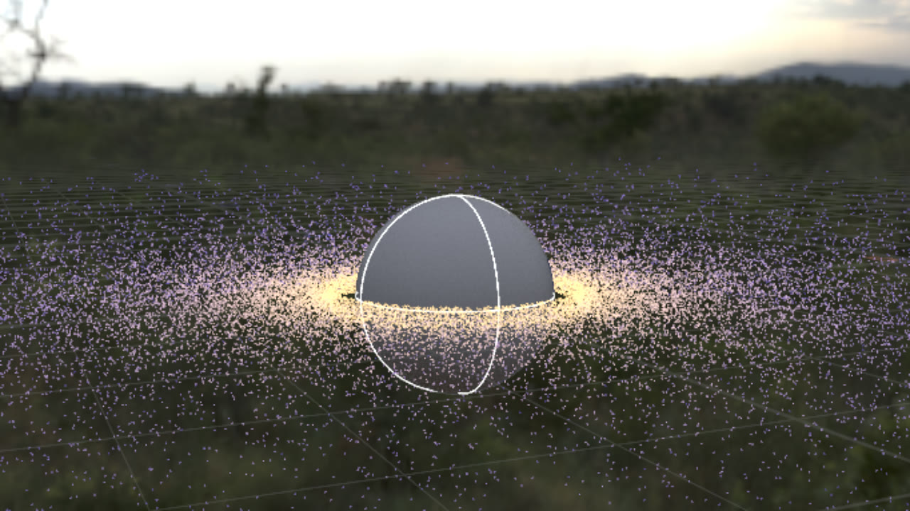
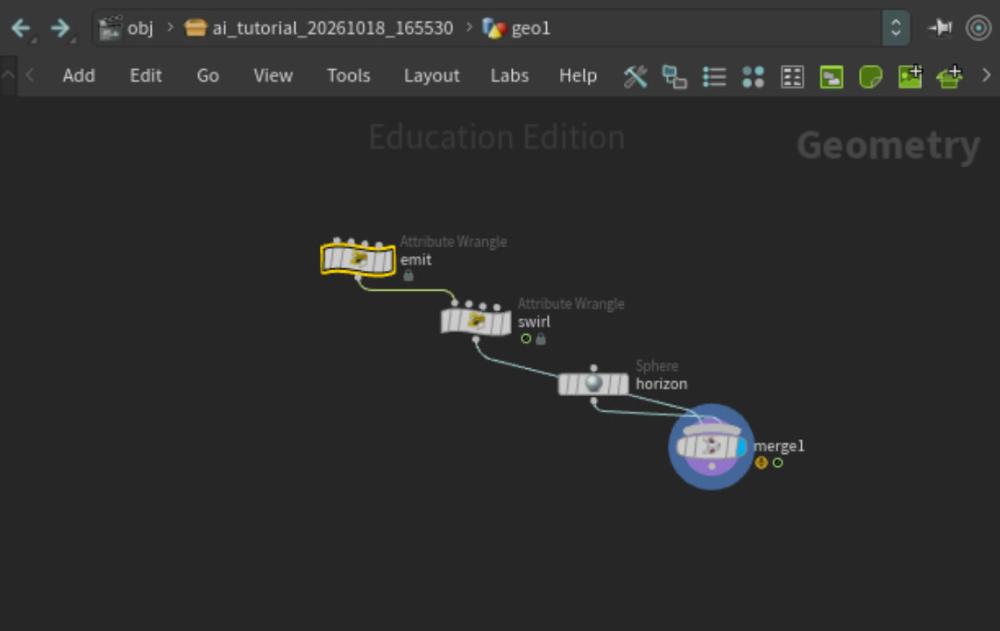
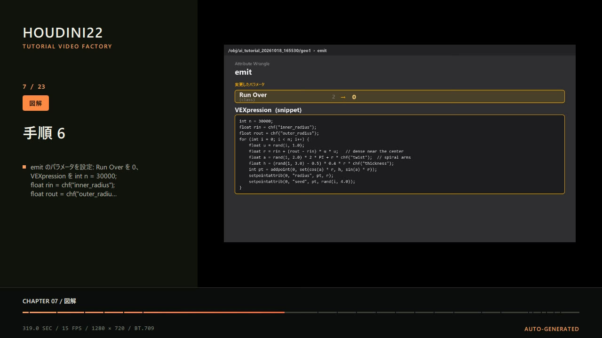

# 実証実験の募集（Slack 用）

**使い方:** ①の本文を、Slack の**キャンバス**（または投稿）に貼ります。画像は、`recruit/` フォルダの3枚を、本文の `![…]` の位置にアップロードします。②の詳細版は、①の**スレッドに返信**として貼ります。`○` は、決まった内容を入れてください。期間は **11/16〜11/21 と 11/23〜11/28** の2回、所要は **約90分（1コマ）で1回だけ**です。2026-11-13 に、卒論担当の先生の指摘（タイトルと冒頭文の修正、重複する説明・「参加すると」の削除、1コマに収める）を反映しました。

**画像の出どころ:** どれも、このシステムが実際に生成したものです（題材: プロシージャルなブラックホール。2026-10-18 の生成）。

| ファイル | 内容 |
|---|---|
| [01-scene.jpg](recruit/01-scene.jpg) | AI が Houdini 上で組んだ、完成したシーン |
| [02-nodes.jpg](recruit/02-nodes.jpg) | AI が実際に作ったノードの構成 |
| [03-video.jpg](recruit/03-video.jpg) | 自動で作られる解説動画の画面 |

---

## ① 本文（キャンバス・親投稿）

# 実証実験ボランティア募集

私は卒業研究で、**作りたいものを日本語で入力すると、AI が実際に Houdini を操作してシーンを作成し、その手順を音声つきの動画で解説してくれるシステム**を開発しています。このシステムを実際に触って評価してくれる学生を募集します。

*「プロシージャルなブラックホール Particle（VEX で作る降着円盤）」と入力しただけで、AI が組んだシーン。*

## こんな学生を募集します

**Houdini 経験を問わず**、こんな学生を募集します。

- Houdini を基礎から楽に学びたい
- 最新機能の解説が欲しい
- 生成 AI と DCC ツールの連携に興味がある

## お願いしたいこと

システムを使って、**「分かりやすかったか」「どこで詰まったか」**を教えてください。分かりにくかった点の指摘も、研究の大切な材料です。

評価するのは**ツールの出来**で、あなたの腕前ではありません。**成績とも無関係**です。

## 募集要項

| 項目 | 内容 |
|---|---|
| **対象** | Houdini に興味のある学生（経験は問いません） |
| **内容** | **1 回だけ**。題材が決まった**固定課題**（Pyro・RBD・雲のどれか）を行います。時間が余った方は、作りたいものを作る**自由課題**（任意）もできます |
| **期間** | **第1回 11/16（月）〜11/21（土）**、**第2回 11/23（月）〜11/28（土）**。どちらか1つの期間に参加します |
| **所要時間** | **約90分（1コマ）**。期間の中で、都合のよい日に |
| **必要なもの** | Windows PC、Houdini 21 または 22（Apprentice の無料版で可） |
| **費用** | **無料**（AI・音声の利用料は運営が負担） |
| **応募・質問** | このスレッド、または ○○○ まで |

**詳しい流れ・導入・データの扱いは、スレッドにまとめました。**

---

## ② スレッド返信（詳細版）

**【詳細】参加の流れ・導入・データの扱い**

**1. 参加の流れ**

1. 応募する（○○○ まで）
2. **同意書**に回答する【○: 同意書の準備ができてから】
3. 事前アンケートに答える（Houdini の経験など。氏名は聞きません）
4. 運営から、**接続先の URL と API キー**を受け取る（お 1 人に 1 つ）
5. パネルを導入する（下の「導入」）
6. 参加する期間（第1回 11/16〜11/21、または第2回 11/23〜11/28）に、**約 90 分（1 コマ）**で課題を行う（1 回だけ）

**2. 課題の中身**

- **固定課題**（参加者ごとに、題材が決まります）: **Pyro**（煙・炎）／ **RBD**（剛体・破壊）／ **雲**（パーティクル）のどれか。**作品物ができたら完了**です。
- **自由課題（任意）**: 固定課題のあと、時間が余った方だけ。自分が作りたいものを、自由に。いつも、このシステムを使えます。**固定課題だけで、参加は完了です。**
- **参加者の半分は、固定課題を「公式ドキュメント・Web 検索のみ」で行います**（システムを使う人と比べるためです）。どちらになるかは、参加の前に、運営からお伝えします。公式ドキュメントのみの課題では、このシステムを使いません。
- 各課題のあとに、**短いアンケート**（難しさ・分かりやすさなど）に答えます。**答えたくない項目は、空欄で大丈夫です。**
- 開始と終了は、Houdini のパネルの「**課題**」タブで押すだけです。かかった時間は自動で記録されます。
- 課題のタブは、**運営が受付を開始してから**使えます。受付の前は、「いま、課題は受け付けていません」と出ます。

**3. 必要なもの**

- **Windows 10 / 11**（64 ビット）
- **Houdini 21 または 22**（Apprentice 可）
- インターネット接続
- 運営から渡す **URL と API キー**（**他の人には見せないでください**）

**4. 導入（約 10 分）**

1. 配布する zip を展開し、**`install.cmd` をダブルクリック**します（管理者権限は要りません）。
2. URL と API キーを入れます。
3. Houdini を起動し、ペインのタブから「**RAGReel Tutorial**」を開きます。

動画も作る場合は、**RAGReel のインストーラー**（配布します）を、先に実行してください。手順は **1 枚の資料にまとめました**（添付）。

**5. 注意してほしいこと**

- **個人情報や、秘密にしたい情報は、質問や課題に入力しないでください。**
- AI が作った内容には、**誤りがありえます**。必ず自分で確かめてください。
- 公式ドキュメントのみの回は、**このシステムを使わないでください**（比較のため）。

**6. データの扱い**

- 結果は、氏名ではなく**番号（P01 など）**で集計します。
- 課題では、**開始・終了の時刻、質問の回数、エラーが出たノードの数、作品物ができたか、アンケートの回答**を記録します。ノードの名前や、質問の文章そのものは、集計には使いません。
- 入力した質問と回答は、運営のサーバーに**履歴として保存**されます。保存期間: ○。
- 論文・発表での使い方: ○（匿名にします／同意した範囲だけ、など）

**7. よくある質問**

| 質問 | 答え |
|---|---|
| Houdini の経験が浅くても参加できますか | はい。むしろ、学び始めの方に使ってほしいシステムです |
| 途中でやめられますか | はい。不利益はありません |
| 途中で Houdini が落ちたら | 課題の記録は残ります。開き直して「続きから開始」を押してください |
| 90 分で終わらなかったら | 時間内にできたところまでで大丈夫です。できなかった点も、研究の材料になります。自由課題は、無理にやらなくて構いません |
| 両方の期間に参加できますか | 参加は、どちらか 1 回だけです |
| 費用はかかりますか | かかりません |
| 動画は公開されますか | 公開は、本人の操作でのアップロードだけです。公開範囲: ○ |

**質問は、このスレッドに書いてください。**

> Slack の通常の投稿では、`**太字**` が反映されないことがあります。その場合は、`**` を `*` に置き換えてください（キャンバスでは、そのまま使えます）。
