# 他の Houdini × AI の道具との比較（2026-10-23）

**目的:** 公開されている近い道具と、このシステムの**共通点・類似点・相違点**を整理して、違いを明確にする。
**比べたもの:** [fxhoudinimcp](https://github.com/healkeiser/fxhoudinimcp)（比較の起点）・[capoomgit/houdini-mcp](https://github.com/capoomgit/houdini-mcp)・[oculairmedia/houdini-mcp](https://github.com/oculairmedia/houdini-mcp)・[Houdini21MCP](https://github.com/orrzxz/Houdini21MCP)・[Synapse](https://github.com/JosephOIbrahim/Synapse)・[dcc-mcp-core](https://github.com/dcc-mcp/dcc-mcp-core)。

## 0. 読む前に（調べ方と限界）
- **調べ方:** 2026-10-23 に、各リポジトリの公開ページ（README）と GitHub の検索 API を読んだ。星の数・更新日は、その時点の値。「Houdini MCP」で検索すると 71 件が見つかったが、そのうち、星の多い順に近い目的のものを選んだ。
- **私は、どの道具も、インストールも実行もしていない。** 以下は、**公開されている説明に書かれていること**だけ。書かれていない項目は、「記載なし」とした（「無い」とは限らない）。
- 各道具の数字（ツール数など）は、作者の説明どおりで、私は再現していない。
- 「本システム」の記述は、このリポジトリのコードと文書で確認できる範囲。

## 1. 一言でいうと

| | 何をするものか |
|---|---|
| **fxhoudinimcp など（MCP サーバー型）** | **外の AI（Claude・Cursor など）が、Houdini を操作する**ための橋。ノード・USD・シミュレーション・レンダリングなどを、AI から広く操作できるようにする |
| **本システム** | **Houdini の知識（ドキュメント）を検索して、チュートリアルと解説動画を作り、配る**ための仕組み。Houdini の操作は、教材を作るために必要な範囲だけ（サンドボックスの中） |

つまり、**同じ「Houdini × AI」でも、向きが違います。** 前者は「AI に Houdini を触らせる」、本システムは「Houdini の知識を、教材にして届ける」。

*図: 立ち位置の違い。位置は、公開された説明からの筆者の整理で、数値ではありません。*

## 2. つなぎ方の違い

*図: 左は fxhoudinimcp の公開された説明による。右は本システム。*

- **MCP サーバー型:** AI クライアントが、別プロセスの MCP サーバーを起動し（stdio）、サーバーが、Houdini の中のプラグインへ、ローカルの HTTP でつなぐ。Houdini の操作は、`hdefereval` で、メインスレッドで実行される。
- **本システム:** Houdini の**中**のパネル（PySide）が、HTTPS で Cloudflare の Worker に、質問・生成を頼む。AI の呼び出し（Claude・Gemini）と鍵は、Worker だけが持つ。Houdini の操作は、パネルの中のツール実行で、同じく `hdefereval` を使う。

## 3. 比較表

| 項目 | fxhoudinimcp | capoomgit | oculairmedia | Houdini21MCP | Synapse | dcc-mcp-core | **本システム** |
|---|---|---|---|---|---|---|---|
| 目的 | Houdini の包括的な MCP サーバー | Houdini を Claude から操作 | Houdini を MCP で操作（hrpyc） | Houdini 21 を Claude Code から操作＋ドキュメント検索 | Houdini 22 内の AI アシスタント | 多数の DCC・エンジンを束ねる制御基盤 | **知識から教材（手順書・動画）を作る** |
| つなぎ方 | stdio の MCP サーバー → ローカル HTTP（8100）→ Houdini 内プラグイン | Houdini 内プラグイン（TCP 9876）＋ブリッジ | FastMCP → hrpyc（18811） | Houdini 内の TCP サーバー（9876）＋ブリッジ | Houdini 内のパネル＋ MCP ＋ WebSocket | Rust/Python の基盤・ゲートウェイ・各 DCC のアダプター | Houdini 内のパネル → HTTPS → Worker |
| ツール数 | **215**（資源 8・プロンプト 9） | 記載なし | **43** | **12**（操作 10・文書 2） | **139** | 47 種の DCC のアダプター | **10**（Houdini の操作 8＋完了の申告 2） |
| 対応する Houdini | 20.5 以上（20.5・21・22 で確認） | 記載なし（例は 19.5） | 記載なし（例は 20.5） | 21 | 22.0.400 で確認 | 記載なし（個別のアダプター次第） | 21・22（22 で実機確認） |
| ドキュメント検索 | 同梱マニュアルの全文検索（3 ツール） | 記載なし | 記載なし | **BM25 の検索（11,238 ページ・オフライン）** | 同梱ヘルプ＋プロジェクトの記憶 | 記載なし | **Cloudflare の RAG（意味＋全文・版ごと・章ごと）** |
| 書き込みの確認 | 記載なし（元に戻すは、ツール1回＝1手） | 記載なし | 記載なし | 記載なし | プレビュー・読み取り専用モード・停止ボタン・ツールごとの確認（Claude Code） | ポリシー・事後確認・監査 | **外部サービスへの書き込みは、毎回の確認。Houdini の操作は、サンドボックスの中だけ** |
| 認証・権限 | **なし**（ローカル限定。任意コード実行ができる） | 記載なし | なし（ローカル限定。ローカル以外は、トークンまたは信頼の設定） | 記載なし | 記載なし | ポリシー・監査 | **APIキー必須**（ロール・ナレッジの範囲・予算） |
| 任意のコード実行 | **あり**（`execute_python`） | あり（コード実行） | あり（コード・HScript） | あり（`execute_code`） | パネルでは、ブロック | 記載なし | **なし** |
| 動画・教材の生成 | なし | なし | なし | なし | なし | なし | **あり**（手順書・台本・音声つき動画・ギャラリー） |
| 外部サービス連携 | なし | 家具・環境アセットの生成（任意） | なし | なし | 複数のモデル・World Labs の取り込み | 47 種の DCC | **MCP クライアント**（10 サービス） |
| 配布 | pip＋自動登録 | ファイルのコピー | 手動・Docker | ファイルのコピー | Windows のセットアップ | pip・CLI | **zip＋install.cmd・インストーラー** |
| ライセンス | MIT | MIT | README は MIT（GitHub の欄は未設定） | MIT | MIT | MIT | リポジトリに記載なし |
| 星（2026-10-23） | 361 | 306 | 81 | 11 | 12 | 70 | — |
| 最終の更新（push） | 2026-10-20 | 2026-06-11 | 2026-09-28 | 2026-02-04 | 2026-10-20 | 2026-10-22 | 2026-10-22 |

## 4. 共通点・類似点・相違点

### 共通点（同じことをしている）
- **Houdini の Python（`hou`）を使って、ノードを作る・つなぐ・パラメータを変える**。結果の確認（ノードの情報・ジオメトリの検査）もできる。
- **メインスレッドで実行する**（`hdefereval`）。Houdini の画面と競合しないようにする。
- **ビューポートの画面を撮る**（fxhoudinimcp・oculairmedia も、画面の取得を持つ）。
- **ドキュメントを検索して、AI に渡す**（fxhoudinimcp は全文検索、Houdini21MCP は BM25、本システムは RAG）。
- **ローカルで動かす部分がある。** どれも、Houdini の PC の中に、何かを置く。

### 類似点（似ているが、同じではない）
| 観点 | 似ている点 | 違い |
|---|---|---|
| ドキュメント検索 | Houdini21MCP は、**Houdini 21 の公式ドキュメントを索引にして、検索**する | あちらは**オフラインの BM25**（標準ライブラリだけ）。本システムは**クラウドの RAG**（意味＋全文・出典の番号・作業場所の章・版ごと）。あちらは**手元で完結**、こちらは**回答に出典と根拠の経路**がつく |
| Houdini 内のパネル | Synapse も、**Houdini の中のパネル**で動く | Synapse は**汎用のアシスタント**（Solaris の構築・ノードの説明など 139 ツール）。本システムは**チュートリアル生成に特化**（10 ツール） |
| 安全の考え方 | Synapse は、パネルで、削除・任意のコード・レンダリングなどを止める。本システムも、任意のコード実行を持たない | Synapse は、プレビュー・停止・上限（25 往復・10 分・300 万トークン）を持つ。本システムは、**サンドボックスと、キーごとの予算**で止める |
| 多くのサービスを束ねる | dcc-mcp-core は、多数の DCC を、1 つの基盤で束ねる | あちらは**制御の基盤**。本システムの MCP は、**外部の SaaS（Notion・GitHub など）を、チャットから使う**ためのもの（DCC は束ねない） |

### 相違点（本システムにしかない／あちらにしかない）

**本システムにあって、あちらに（公開された説明では）見当たらないもの**
1. **教材づくりの流れ全体**: 授業の設計 → ノードの組み立て → 採点 → 手順書 → 台本 → 音声つきの動画 → ダッシュボード。
2. **キーごとの権限と予算**: ロール、使えるナレッジの範囲、Claude のトークン・音声の文字数の上限。複数人に配る前提。
3. **回答に出典がつく**: 出典の番号・引用した部分・更新日・根拠の経路。
4. **配布の仕組み**: zip＋install.cmd、インストーラー、管理画面。
5. **外部サービスとの連携（MCP クライアント）と、書き込みの確認**。

**あちらにあって、本システムに無いもの**
1. **Houdini を広く操作できること**: シミュレーション・USD/Solaris・PDG・レンダリング・HDA など（fxhoudinimcp は 215 ツール、Synapse は 139）。**本システムは、ノードの操作 8 つだけ**。
2. **外の AI クライアントから使えること**: Claude Code・Cursor などから、そのまま Houdini を操作できる（MCP サーバー）。**本システムは、Houdini のパネルからしか使えない**。
3. **ローカルで完結すること**: ネットワークと鍵が要らない。本システムは、**チュートリアル生成・動画の台本・音声が、Cloudflare の Worker と鍵を必要とする**（検索だけなら、手元のブリッジ〔ChromaDB〕でも動く）。
4. **セッション管理・複数の Houdini の切り替え・コンタクトシート**（fxhoudinimcp）。
5. **オフラインの検索**（Houdini21MCP）。

## 5. 取り入れられそうなもの（今は実装していない）

| 出典 | 内容 | 本システムでの使いみち | 優先 |
|---|---|---|---|
| fxhoudinimcp | **まとめて組み立てる**（`build_network`）。1 つずつ作ると約 800 ms（10 ノード）、まとめると約 66 ms と説明されている（作者の数字） | エージェントの 1 反復あたりの時間を減らせるかもしれない。**自前で測ってから** | 中 |
| fxhoudinimcp | **ツール 1 回＝元に戻す 1 手** | サンドボックスを使っているので、必要性は低い | 低 |
| Synapse | **1 回の処理の上限**（往復・時間・トークン）、**停止ボタン**、**読み取り専用モード** | 本システムにも、反復の上限（80 回）・費用の上限はある。**生成の途中で止めるボタンは、確認した範囲では見当たらない**ので、足す価値がある | **高** |
| Synapse | **プレビュー（計画だけ返す）** | 生成の前に、授業の設計だけを見せて、承認してもらう流れに使える | 中 |
| oculairmedia | **返り値の大きさの上限・切り詰め**、ノード種別の**キャッシュ** | 長いログ・大きなジオメトリの検査結果を、AI に渡す量の制御 | 中 |
| dcc-mcp-core | **事後確認**（書いて、読み戻して確かめる）、監査 | 本システムの `cook_node` と `confirm_tutorial` が、近い役割 | 低（すでにある） |
| Houdini21MCP | **オフラインの検索** | Worker に届かないときの代替。**クラウドの索引を手元に複製する**ので、更新の管理が増える | 低 |
| （逆方向） | **本システムの検索を、MCP サーバーとして公開する** | fxhoudinimcp などを使っている人が、**本システムの Houdini 知識（出典つき）を、そのツールから引ける**。手元用の MCP サーバー（`scripts/rag_mcp_server.py`・検索と件数の 2 ツール）は、すでにある。Worker 側を、リモートの MCP サーバーにするのは未着手 | **高（組み合わせられる）** |

## 6. 組み合わせ方の考え方
- **競合ではなく、補い合う関係**です。fxhoudinimcp などは「操作」、本システムは「知識と教材」。
- 「Houdini を広く操作したい」なら、fxhoudinimcp（または Synapse）。「Houdini の使い方を、出典つきで調べて、教材にしたい」なら、本システム。
- 両方を使うなら、**本システムの知識検索を、MCP サーバーとして公開**するのが、いちばん自然な接点です（§5 の最後の行）。

## 7. 確認できていないこと
- 各道具の動作・品質は、**実際に動かして確かめていない**。
- 本システムの動作のうち、**Houdini の画面での操作**（Parm ペインの撮影・進行バー・チャットの配置など）は、実機で確認できていないものがある（hython と単体テストでは確認済み）。
- 「操作できる範囲」の位置づけ（図 9）は、ツール数と説明からの**筆者の整理**で、客観的な指標ではない。
- 本システムのリポジトリに、**ライセンスの記載がない**。公開・配布の範囲を決めるときに、決める必要がある。

## 出典（2026-10-23 に参照）
- fxhoudinimcp: https://github.com/healkeiser/fxhoudinimcp
- capoomgit/houdini-mcp: https://github.com/capoomgit/houdini-mcp
- oculairmedia/houdini-mcp: https://github.com/oculairmedia/houdini-mcp
- Houdini21MCP: https://github.com/orrzxz/Houdini21MCP
- Synapse: https://github.com/JosephOIbrahim/Synapse
- dcc-mcp-core: https://github.com/dcc-mcp/dcc-mcp-core
- 検索: GitHub の検索 API（`houdini mcp`、星の多い順）
